<div align="center">

<picture>
  <source media="(prefers-color-scheme: dark)" srcset="docs/brand/fchat-logo-dark.svg">
  
</picture>

**Free, open source Instagram DM automation you host yourself.**<br>
Someone comments a keyword on your reel, gets a DM with a button, is asked to follow you and receives your link.

[](#license)
[](package.json)
[](CONTRIBUTING.md)
[](https://nextjs.org)

[](https://vercel.com/new/clone?repository-url=https%3A%2F%2Fgithub.com%2Fpaidbyfacu%2Ffchat&project-name=fchat&repository-name=fchat&stores=%5B%7B%22type%22%3A%22integration%22%2C%22integrationSlug%22%3A%22neon%22%2C%22productSlug%22%3A%22neon%22%2C%22protocol%22%3A%22storage%22%7D%5D)

[Quick start](#quick-start) · [Installation](#installation-step-by-step) · [Meta setup](docs/meta-setup.md) · [Contributing](CONTRIBUTING.md) · [Guía en español](https://paidbyfacu.com/guias/fchat)

</div>

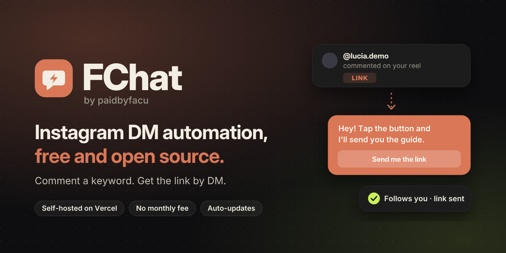

FChat runs on your own Vercel account with your own Meta app. No subscription, nobody else sees your data, and it updates itself.

> **¿Hablas español?** La guía completa de instalación en español, paso a paso y con capturas, está en **[paidbyfacu.com/guias/fchat](https://paidbyfacu.com/guias/fchat)**. The dashboard itself is in Spanish today; an English interface is on the way.

## Contents

- [Features](#features)
- [Screenshots](#screenshots)
- [Quick start](#quick-start)
- [What you need](#what-you-need)
- [Installation, step by step](#installation-step-by-step)
  1. [Prepare your Instagram](#step-1-prepare-your-instagram)
  2. [Install FChat on Vercel](#step-2-install-fchat-on-vercel)
  3. [Create your administrator account](#step-3-create-your-administrator-account)
  4. [Connect Instagram with Meta](#step-4-connect-instagram-with-meta)
  5. [Turn on automatic updates](#step-5-turn-on-automatic-updates)
  6. [Create your first automation](#step-6-create-your-first-automation)
  7. [Test it](#step-7-test-it)
- [Using FChat](#using-fchat)
- [Your project on Vercel](#your-project-on-vercel)
  - [View the logs](#view-the-logs)
  - [Add or change a variable](#add-or-change-a-variable)
  - [Redeploy](#redeploy)
  - [Your address and a custom domain](#your-address-and-a-custom-domain)
- [Troubleshooting](#troubleshooting)
- [If you forget your password](#if-you-forget-your-password)
- [Environment variables](#environment-variables)
- [Run it on your computer, on Windows or Mac](#run-it-on-your-computer-on-windows-or-mac)
- [How it works](#how-it-works)
- [Security](#security)
- [Contributing](#contributing)
- [Fair use](#fair-use)
- [Disclaimer and terms](#disclaimer-and-terms)
- [License](#license)

## Features

- **Comment to DM.** When someone comments a keyword, they get a private message right away. Upper case, lower case and accents all match.
- **One post, several or all of them.** Pick one or more posts or reels, any post on the account, or the next one you publish.
- **Ask for a follow.** Before sending the link, FChat checks whether the person follows you. If not, it asks them to follow and shows a **Following** button. You can require the follow, or ask a set number of times and send the link anyway.
- **Public reply under the comment.** Up to 10 variants picked at random, so Instagram does not flag it as spam.
- **Inbox.** All your conversations in one place: open, closed, unread and starred, with reminders, internal notes and manual replies from the dashboard.
- **Templates.** Pick a template, change the keyword and the link, and turn it on.
- **Stats.** How many people commented, got the message, tapped the button, followed you and received the link.
- **Retries.** If Instagram rate-limits a send, FChat tries again later on the same step, without repeating messages.
- **Automatic updates.** Every new version reaches your Vercel on its own, including the improvements other people contribute.

FChat only uses Meta's official Instagram API, the same one paid tools use. It never logs in with your Instagram username and password and never pretends to be a person. TikTok and message sequences are coming in a future version.

## Screenshots

All screenshots come from a test installation with made-up data.

| | |
| --- | --- |
|  |  |
| **Inbox:** the comment, every message the automation sent and what the person tapped. | **Wizard:** the phone preview shows what people will see. |
|  |  |
| **Home:** templates, next steps and the last 7 days. | **Stats:** how many people went through each step. |

## Quick start

1. Switch your Instagram account to **professional** and allow access to messages.
2. Click **Deploy with Vercel** above, accept the free **Neon** database and wait about 3 minutes.
3. Open your FChat and create your administrator account.
4. Follow the in-app guide **Connect your accounts** to create your Meta app and connect Instagram. The [Meta setup guide](docs/meta-setup.md) has a screenshot of every screen.
5. Turn on automatic updates, pick a template and publish your first automation.

No code, no terminal and no environment variables. The detailed version of each step is below.

## What you need

- A **professional** Instagram account, business or creator. You can switch for free in the Instagram app.
- A **second Instagram account** for testing: yours or someone you trust.
- A [GitHub](https://github.com) account. The [Vercel](https://vercel.com) account is created during the installation, by signing in with GitHub. Vercel's free plan, **Hobby**, is enough.
- A Facebook account to log in to [Meta for Developers](https://developers.facebook.com). The developer account is free and you create it during the guide.

You do not need to install anything on your computer or write any code. Everything happens in the browser, so the steps are the same on **Windows** and **Mac**. Chrome, Edge, Safari or Firefox all work.

## Installation, step by step

About 30 minutes in total, and you only do it once. Meta, Vercel and GitHub change their dashboards often: if a button has a different name or is somewhere else, look for the closest one.

The dashboard is available in English and Spanish: it follows your browser language, and you can change it in **Settings**. The FChat screenshots in this guide show the Spanish interface.

### Step 1. Prepare your Instagram

In the Instagram app on your phone, with the account you want to automate:

1. Switch it to **professional**: **Settings** › **Account type and tools** › **Switch to professional account**. Choose business or creator.
2. Allow access to messages: **Settings** › **Messages and story replies** › **Message controls** › **Connected tools** › turn on **Allow access to messages**.

### Step 2. Install FChat on Vercel

[Vercel](https://vercel.com) is where your FChat lives: it publishes it on the internet and gives it an address. Its free plan is called **Hobby** and it is enough: you do not need the Pro plan.

#### 2.1. Create your Vercel account

If you already have a Vercel account, log in with it and skip to 2.2.

1. Click the **Deploy with Vercel** button above. If you are not logged in, Vercel shows "Your first deploy is just a sign-up away."
2. Click **Continue with GitHub** and log in with your GitHub account. With that permission, Vercel creates your copy of FChat in your GitHub and publishes it again every time it changes.
3. The first time, GitHub asks you to authorize Vercel to use your account: accept it.

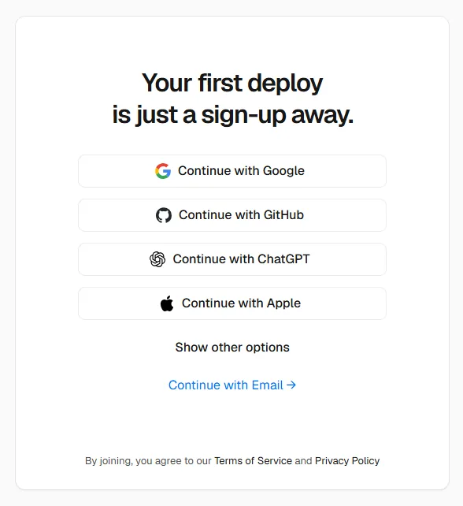

#### 2.2. Create your copy of FChat

Once you are in, **New Project** opens with "Cloning from GitHub paidbyfacu/fchat". Vercel copies FChat to a new repository in your GitHub, and publishes and updates it from there.

1. **Git Scope:** your GitHub account. The repository is created there.
2. **Private Repository Name:** the name of your copy. Keep "fchat" or choose another.
3. The lock next to the name decides who can see the repository. Closed, it is private and only you see it. Click it to open it: the title changes to **Public Repository Name** and anyone can see the code. Both work, because your data and your keys never go into the repository. If you are not sure, keep it private.
4. **Vercel Team:** your Vercel team, labeled **Hobby**, the free plan. Leave it as is.
5. Click **Create**.

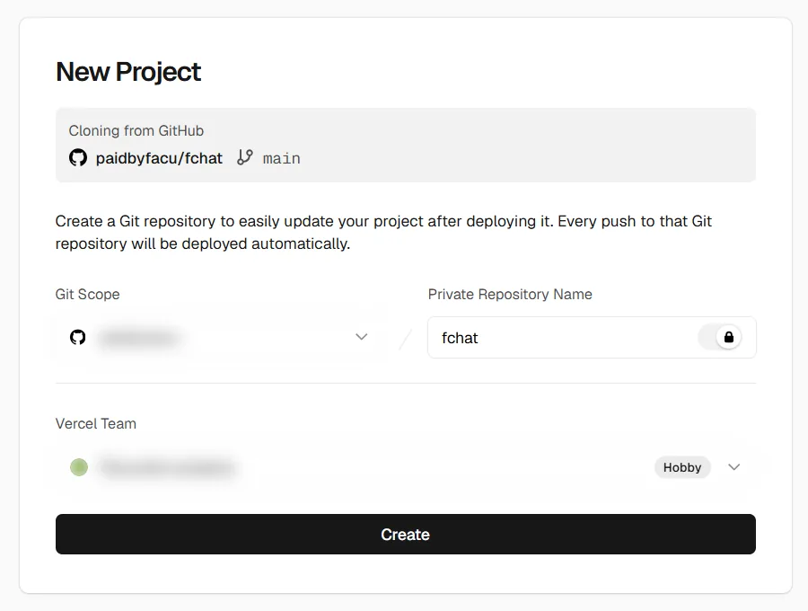

This is how it looks with the lock open, if you choose a public repository:

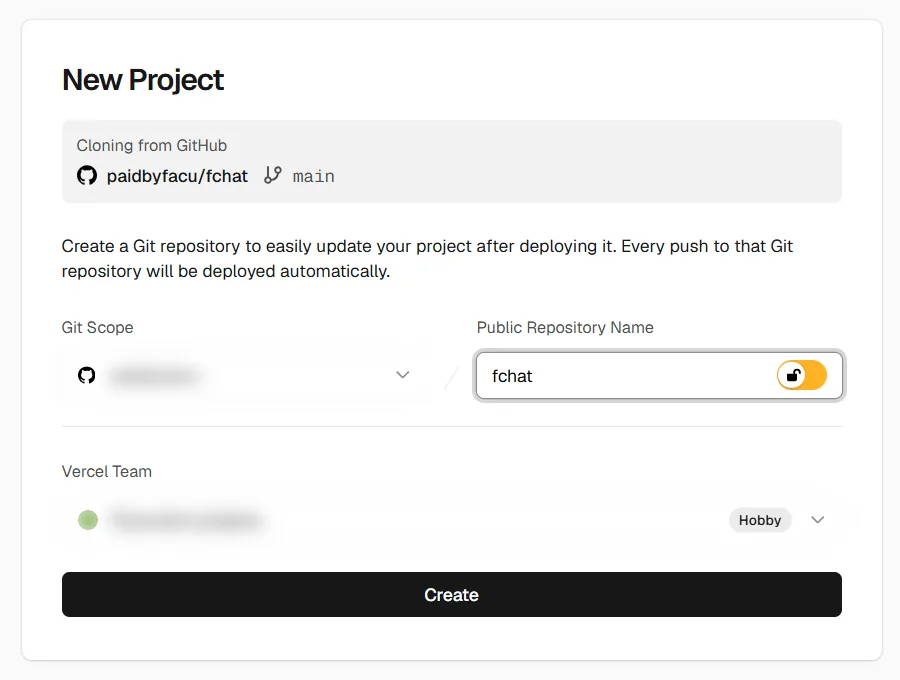

#### 2.3. Add the Neon database

FChat stores your automations, contacts and conversations in a Neon Postgres database. Vercel creates it inside your account: you do not need a separate Neon account.

1. In **Add Products**, under "Install all the mandatory products", you see **Neon**. Click **Add**.

   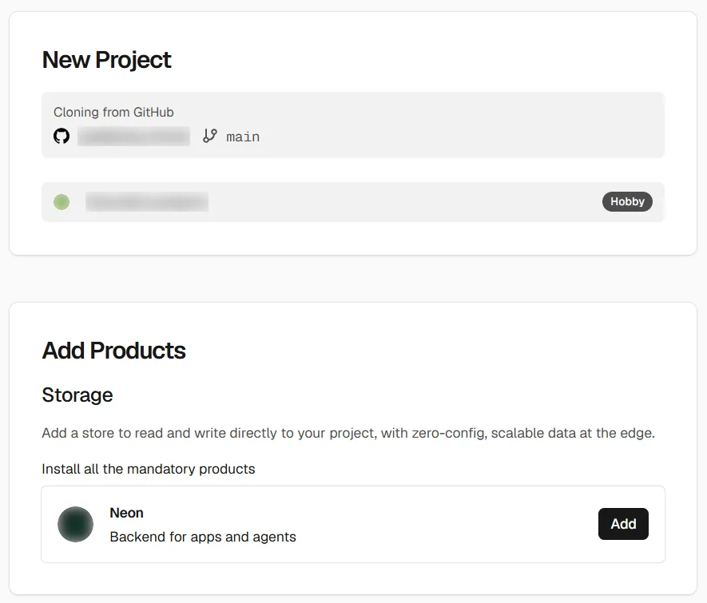

2. The **Install Integration** panel opens. Under **Region**, choose **Washington, D.C., USA (East)**: that is where Vercel runs your FChat unless you change it, and with the database nearby it responds faster.
3. **Auth** and **Realtime** can stay as they are: FChat does not use them.

   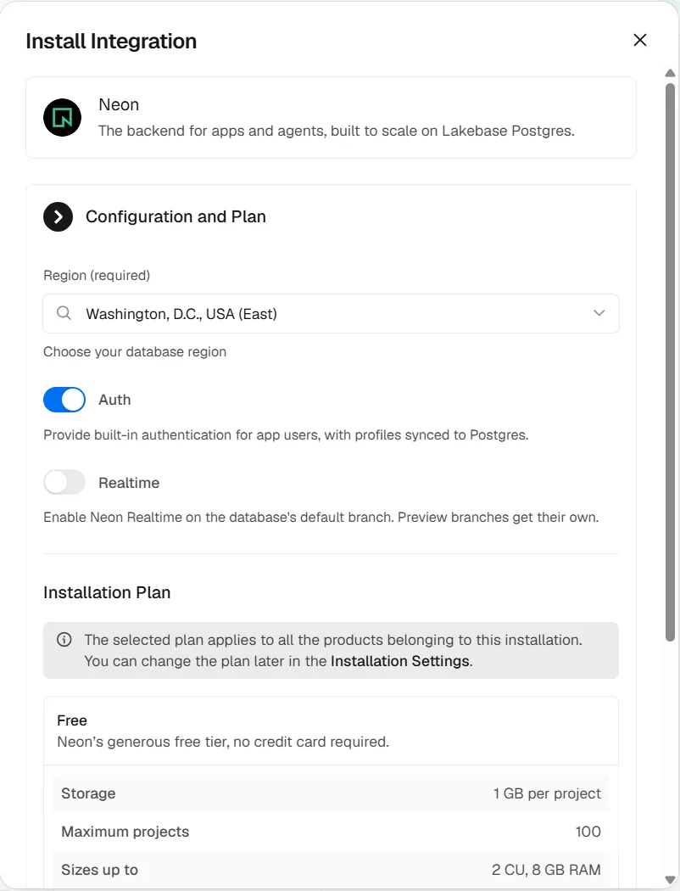

4. Further down, under **Installation Plan**, choose **Free**: "Neon's generous free tier, no credit card required." It includes 1 GB per project, which is more than enough. Click **Continue**.

   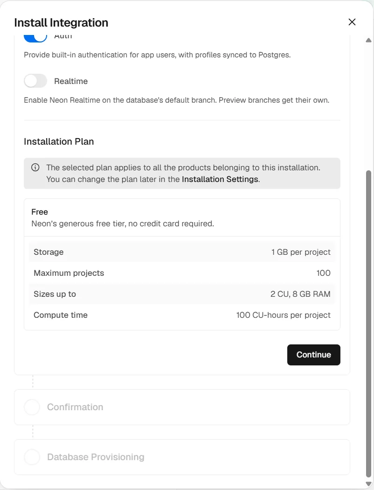

5. Under **Confirmation** you see the database name in **Resource Name** and what you chose. Click **Create**.

   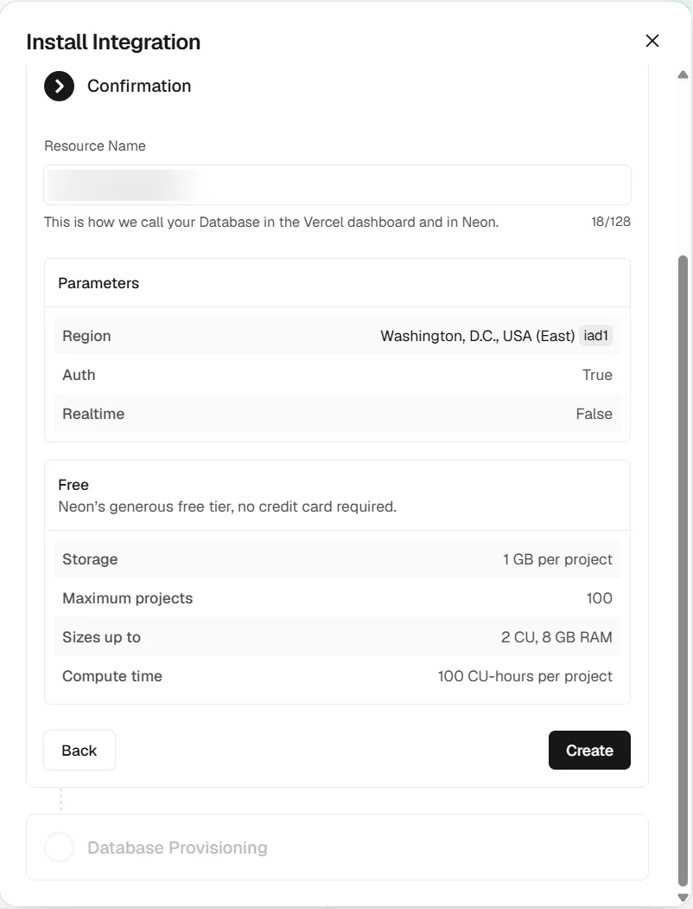

6. When "Your Neon database is ready to use" appears, click **Done**.

   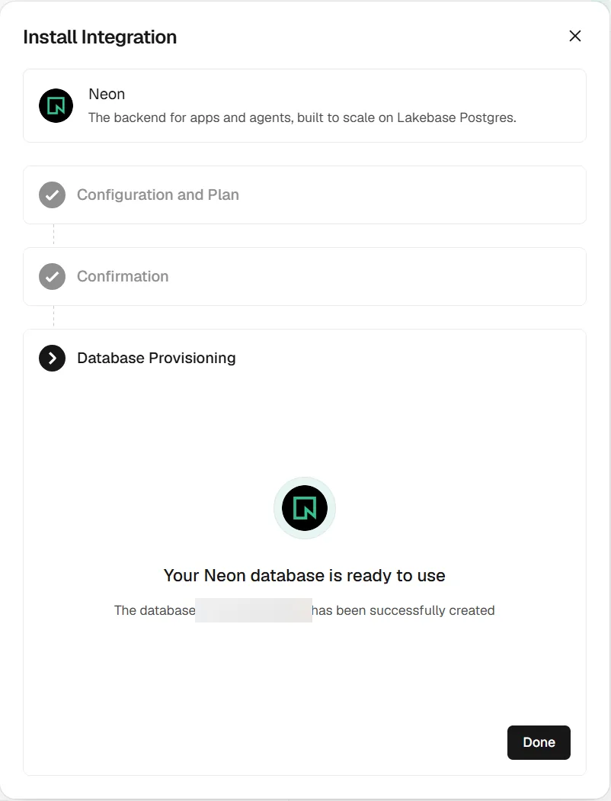

Vercel connects the database to your project on its own: it sets `DATABASE_URL` and other variables starting with `POSTGRES_` or `PG`. You do not need to copy anything.

If you have two-factor authentication on, Vercel may ask for your code in the **Verify Your Identity** window: type it and click **Verify Code**.

#### 2.4. Wait for the deploy

With the database ready, Vercel publishes your FChat. This is called a deploy and takes a minute or two: during the test for this guide it took 49 seconds. When it is done, **Deployed to Production** appears.

Click **Continue to Project** to go to your project's dashboard. **Add Domain**, **Enable Speed Insights** and everything else on that screen are optional: FChat does not need them.

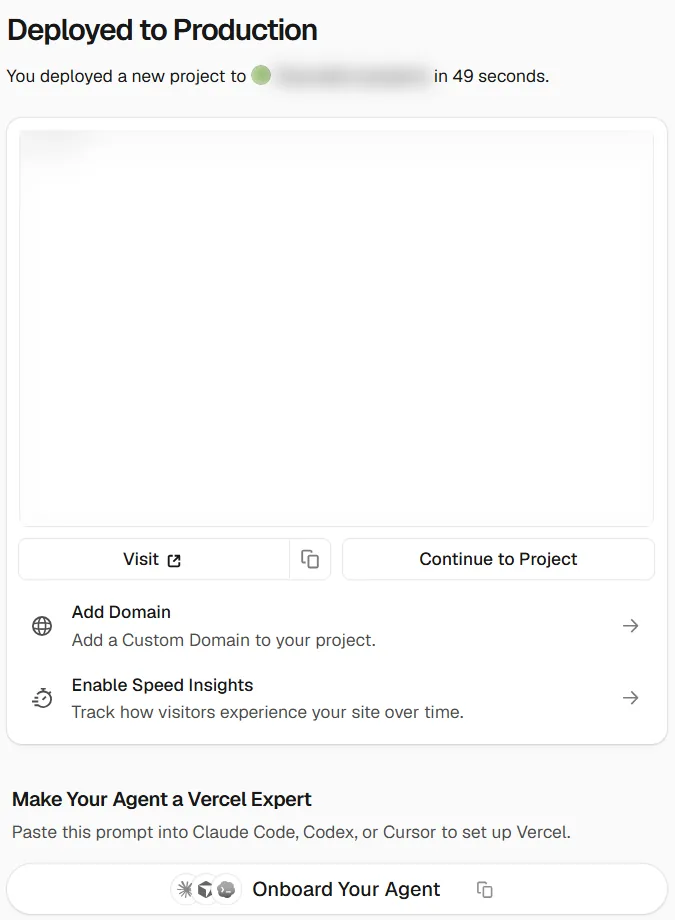

#### 2.5. Open your FChat and save its address

In the project dashboard, the **Production Deployment** card shows your deploy with the status **Ready**.

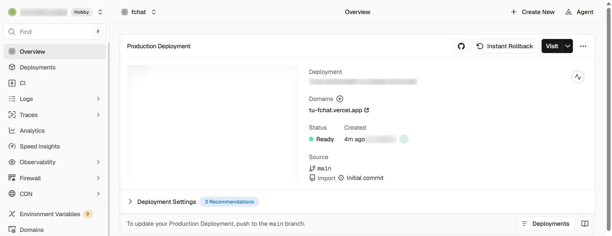

- Under **Domains** is your FChat address, something like `your-fchat.vercel.app`. Vercel builds it from the project name and, if someone else already uses that name, adds something at the end.
- Click **Visit** to open your FChat and bookmark it. Check that the address in the browser is the same one shown under **Domains**.
- The same address appears in the left menu under **Domains**, with "Valid Configuration" and the **Production** label.

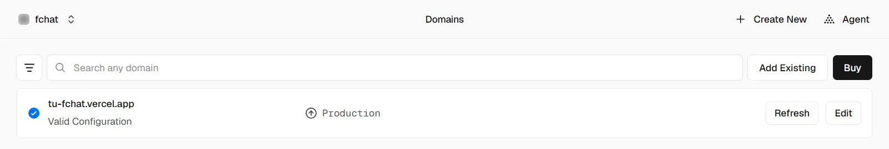

You do not need to set environment variables: secrets are generated the first time you open FChat.

#### Which address to use

Your FChat has a single main address: the one under **Domains**. It is the one you use to open the dashboard and the one that goes into Meta.

- **Use FChat's Copy buttons.** In **Connect your accounts**, every address Meta asks for is already built with your main address. Copy it with its button instead of typing it.
- **The webhook is your main address with `/webhook` at the end:** `https://your-fchat.vercel.app/webhook`. With `https://` at the start, no extra slash at the end and no spaces.
- **Do not use the long address.** Under **Deployment**, Vercel shows another, longer address with random letters and your team name, like `fchat-xxxxxxxxx-your-team.vercel.app`. Vercel creates a new one for every deploy and protects it: anyone who opens it without being logged in to your Vercel account sees **Log in to Vercel**. Meta cannot get in either, so the webhook does not work with that address.

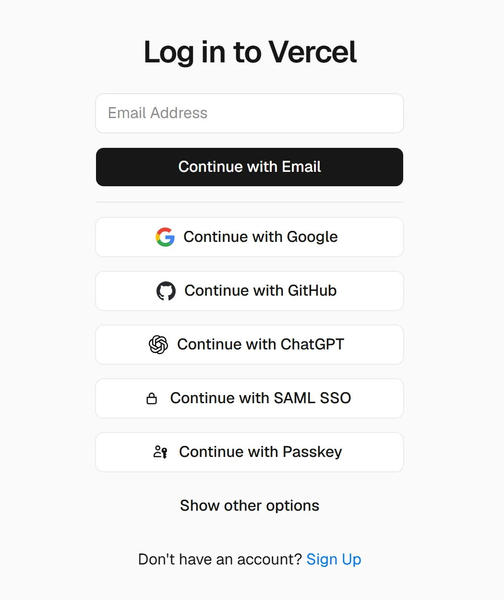

### Step 3. Create your administrator account

Open your FChat with **Visit** **as soon as the deploy finishes**. The setup screen appears:

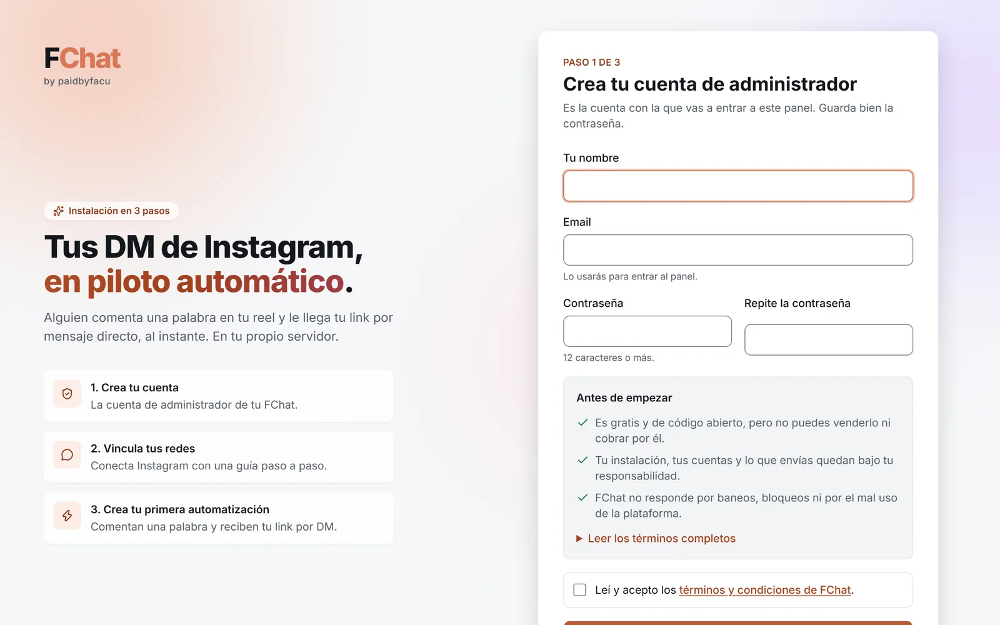

1. Type your name, your email and a password of 12 characters or more.
2. Read and accept the [terms of use](TERMS.md).
3. Click **Create my account**.

That account is the only one that can log in to the dashboard. Once it exists, the setup screen no longer appears.

### Step 4. Connect Instagram with Meta

After you create the account, FChat takes you to **Connect your accounts**: a 7-step guide inside the dashboard, with a button to copy every value Meta asks for. Each step is checked off on its own when FChat detects you did it.


1. Prepare your Instagram.
2. Create your app in Meta.
3. Paste your app ID and secret in FChat.
4. Set up the webhook.
5. Connect your Instagram account.
6. Publish your Meta app.
7. Create your first automation and test it.

**The full guide, with a screenshot of every Meta screen, is in [docs/meta-setup.md](docs/meta-setup.md).** Follow it with FChat open in one tab and Meta in another. It takes about 15 minutes.

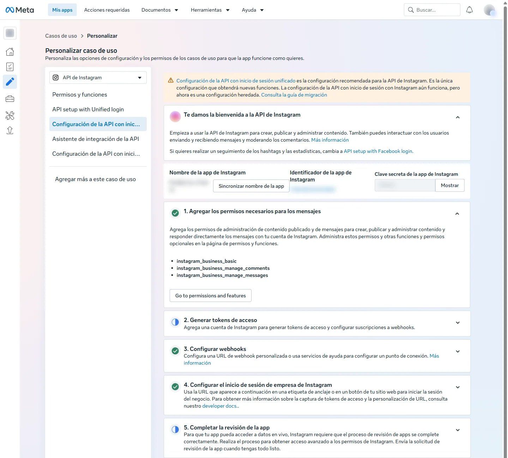

When you finish, FChat confirms that Instagram is connected and your account shows as **Connected**:


### Step 5. Turn on automatic updates

FChat updates itself with a GitHub Actions workflow: a task GitHub runs on its own in your repository. The Vercel button does not copy the repository's `.github` folder, which is why you do this once from the dashboard.

1. In FChat: **Settings** › **Updates**. You see a prompt to turn on automatic updates with the **Enable on GitHub** button.

   

2. Click **Enable on GitHub**. GitHub opens with the file `actualizar-fchat.yml` already written, inside your repository's `.github/workflows`. If GitHub asks you to log in, use the same account you used for Vercel. Do not change the text.
3. At the top right, click **Commit changes...**.

   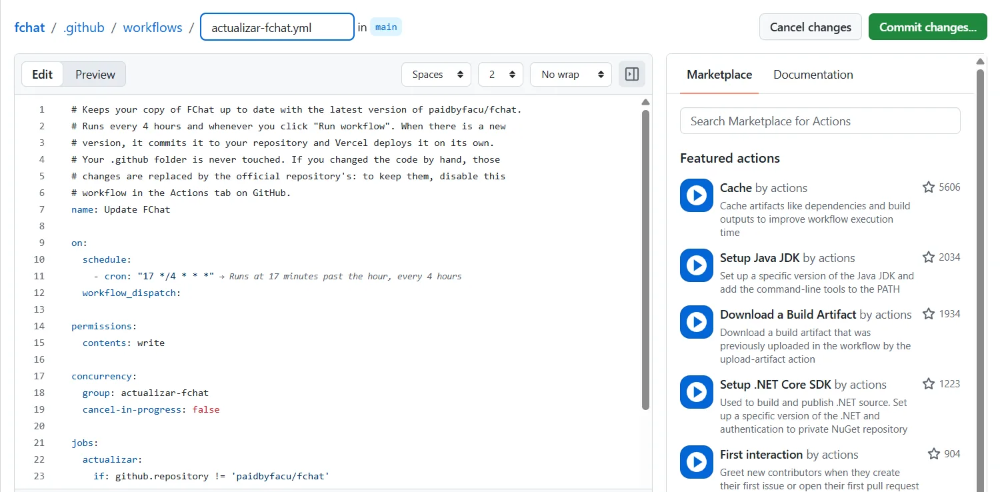

4. In the **Commit changes** window, keep the message as it is and **Commit directly to the main branch** selected. Click **Commit changes**.

   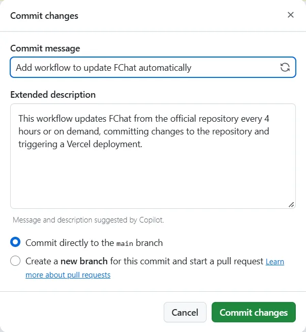

5. Vercel redeploys on its own. In a few minutes, **Settings** › **Updates** says **Active**.

   

From then on, every 4 hours GitHub checks whether there is a new version of FChat. If there is, it copies it to your repository and Vercel publishes it in a few minutes. Your data is untouched: it lives in the database, not in the code.

#### Update right away

In **Settings** › **Updates**, click **Update now**. The **Actions** tab of your repository opens on the FChat workflow, called **Update FChat**.

1. Click **Run workflow**.
2. In the window that opens, keep **main** under "Use workflow from" and click **Run workflow** again.

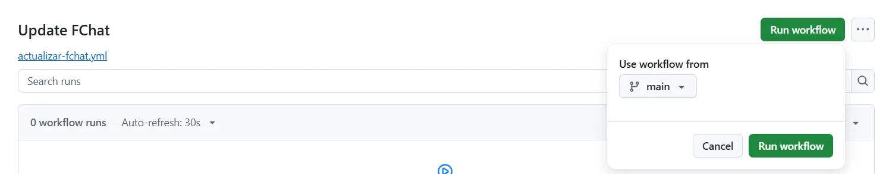

The run shows up in that workflow's list. If there was a new version, Vercel publishes it in a few minutes.

#### If you change the code yourself

Every update replaces your repository's code with FChat's. If you changed something and want to keep it, turn the workflow off: in the **Actions** tab, choose the FChat workflow, click the **...** button next to **Run workflow** and then **Disable workflow**. GitHub asks "Disable workflow?": click **Disable workflow** again.

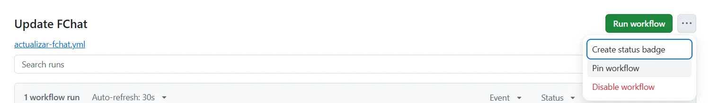

Better yet, send your change as a pull request to this repository: once accepted, it reaches you and everyone else through the normal updates. See [Contributing](#contributing).

#### If GitHub pauses the updates

In a **public** repository, GitHub pauses scheduled tasks when the repository goes 60 days without changes, and usually emails you. To turn them back on, open your repository's **Actions** tab, choose the FChat workflow and click **Enable workflow**. The same works if you turned it off yourself: in that case the notice says "This workflow was disabled manually."

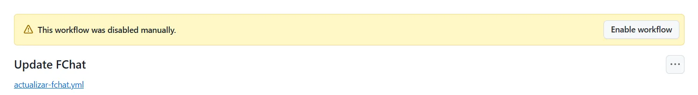

#### If your repository is private

GitHub Actions is free in public repositories. In private ones, each run uses minutes from your GitHub account's free monthly quota, and this workflow uses very few. If your GitHub account has a failed payment or reached its spending limit, GitHub does not start the workflow and shows "The job was not started because recent account payments have failed or your spending limit needs to be increased." To make it run again, fix your GitHub account's billing or make the repository public.

### Step 6. Create your first automation

1. In FChat: **Automations** › **Templates**. Pick **Auto-DM links from comments**, or **Get followers before sending the link** if you want people to follow you before they get it.

   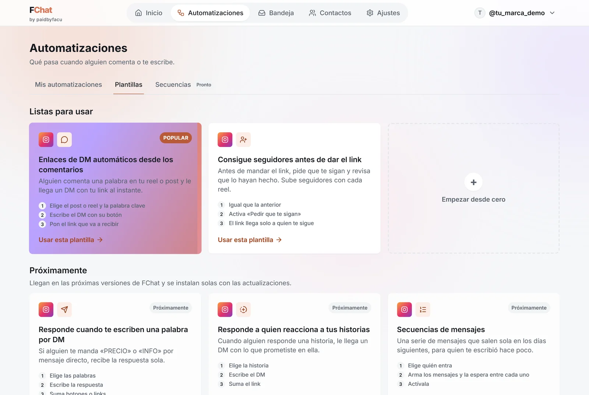

2. Fill in the wizard. On the right, the phone preview shows what the person will see:
   - **Name:** only you see it, in the list.
   - **When someone comments on:** posts or reels you choose, any post or reel, or the next one you publish. Click **Choose posts** and select one or more.
   - **And the comment contains:** the keywords that trigger it, for example `LINK`. Type each one and press Enter. You can also add words that stop it.
   - **Also reply under the comment:** the public replies, for example "Sent you a DM!". One is picked at random each time.
   - **First DM:** the private message with its button, for example "Continue". The button is required: without a tap, Instagram does not let the conversation go on.
   - **Ask to follow:** the message for people who do not follow you and how many times to ask. With **Until they follow**, only followers get the link.
   - **DM with the link:** the final message, with the button text and your link.

   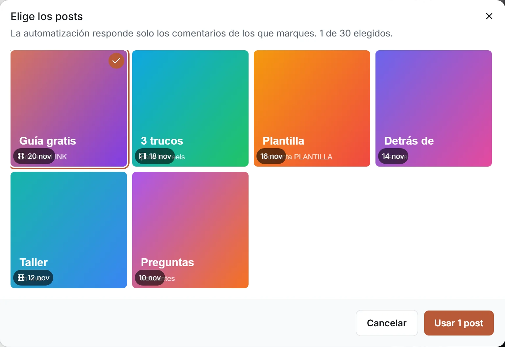

   

3. Click **Publish**. A notice confirms that the automation is active and already answering comments.

   

To finish it later, click **Save draft**.

### Step 7. Test it

1. From your **second** Instagram account, comment the keyword on the post you chose, for example `link`. Comments from your own account do not trigger anything.
2. The second account gets the message with the button. Tap it.
3. If you chose to ask for a follow and that account does not follow you, it gets the request with the **Following** button. Follow and tap it.
4. The link arrives. The conversation shows up in the FChat **Inbox** and the numbers in the automation.

If nothing arrives, see [Troubleshooting](#troubleshooting).

## Using FChat

### Home

The first thing you see when you log in: templates to get started, the next steps you are missing and the numbers for the last 7 days.


### Automations and stats

**Automations** lists all of yours, active and drafts. Open one to see how many people went through each step in the last 7 days and the messages it sends. From there you edit, pause or delete it.

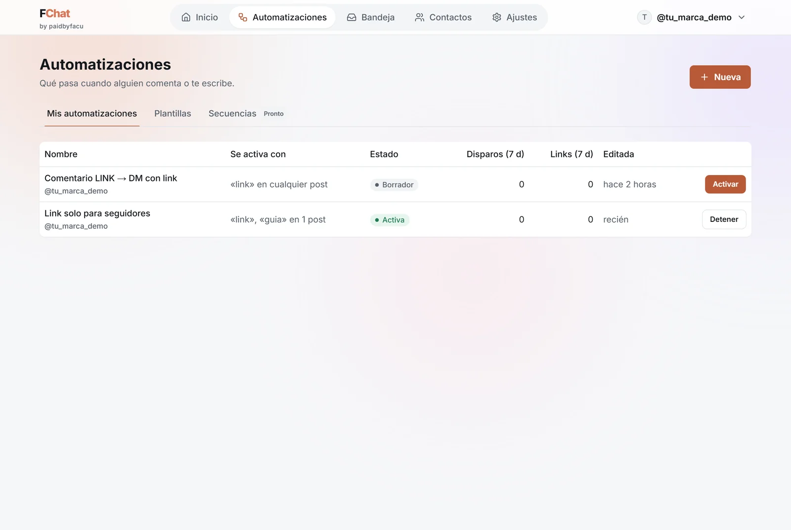


### Inbox

All your Instagram conversations. Filter by open, closed, unread or starred, and set reminders. Open a conversation to see the comment, every message the automation sent and what the person tapped. On the right, their details and whether they follow you. You can reply manually and leave internal notes only you can see.


This is a full conversation: the comment, the message with its button, the link and a reply written from the dashboard.


Instagram lets you reply manually up to 24 hours after each person's last message.

### Contacts

Everyone who interacted with your automations: whether they follow you, whether they tapped a button and whether their 24-hour window is open.

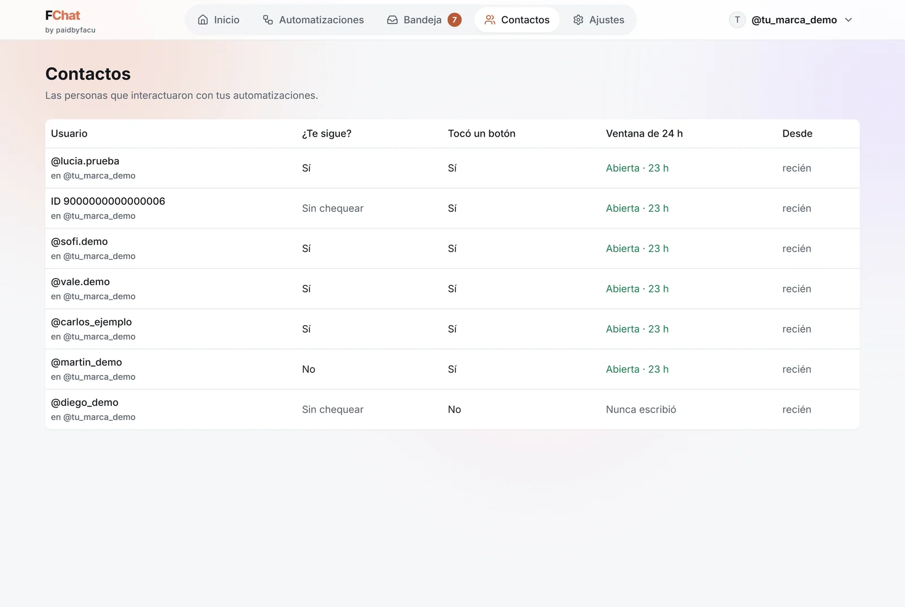

### Settings

- **Connected accounts:** your Instagram account, to reconnect it or reactivate the webhooks.
- **Security:** your password and open sessions, which you can sign out from there.
- **Updates:** your FChat version and automatic updates.
- **Terms and license:** what you accepted during setup.

## Your project on Vercel

You rarely need to open Vercel after installing. When you do, go to [vercel.com](https://vercel.com), open your project and use the left menu: **Deployments**, **Logs**, **Environment Variables** and **Domains** are the only sections this guide uses. **Analytics**, **Speed Insights**, **Firewall** and the rest are optional: FChat does not need them.

### View the logs

**Logs** shows every request your FChat receives and every error. It tells you whether Meta's notifications are arriving.

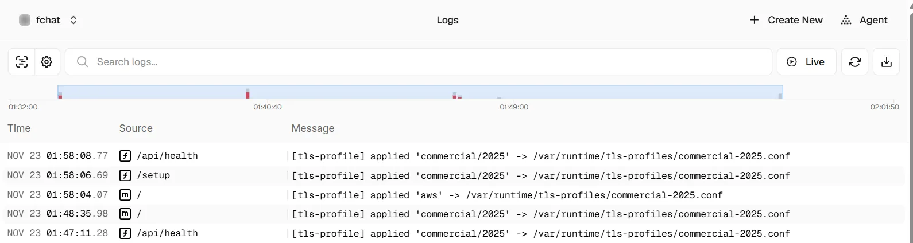

- Each row shows the time, the requested page under **Source** and the message. When Meta sends a notification, a row with `/webhook` appears.
- Type a word in **Search logs...** to filter, for example `webhook` or `error`.
- Click **Live** to watch the logs in real time while you test a comment.
- By default you see the last 30 minutes, "Last 30 minutes". In the filters you can pick a longer period and show only errors.

Rows that say `[tls-profile] applied` come from Vercel and do not mean anything is wrong.

### Add or change a variable

**Environment Variables** holds your project's variables. During the installation, Neon sets its own: `DATABASE_URL`, `POSTGRES_URL`, `PGHOST` and similar ones. Vercel may mark some with **Needs Attention**: it is a Vercel suggestion to rotate keys, not an FChat error. Do not change or delete them, or FChat will lose access to your database.

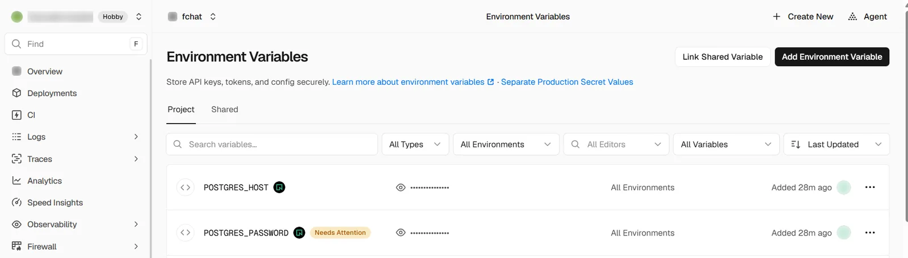

To add a variable, such as `OWNER_PASSWORD` or `IG_ACCESS_TOKEN`:

1. Click **Add Environment Variable**.
2. Under **Type**, choose **Secret** for passwords, keys and tokens: once saved, it cannot be viewed again. For anything that is not secret, like your email, choose **Config**.
3. Under **Key**, type the exact variable name, in upper case, for example `IG_ACCESS_TOKEN`.
4. Under **Value**, paste the value with no spaces at the start or end. **Note (Optional)** can stay empty.
5. If you need another variable, click **Add new variable** and repeat steps 3 and 4.
6. Under **Environments**, keep **Production** and click **Save**.

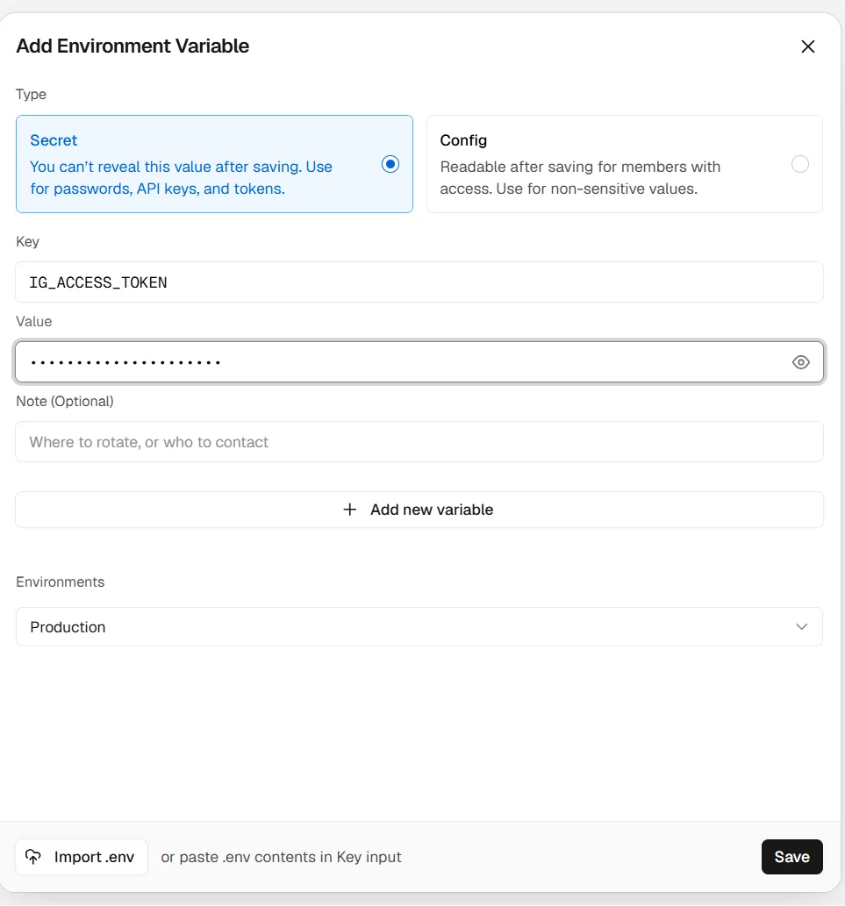

A new or changed variable does not apply on its own: you need to [redeploy](#redeploy) afterwards. To change or delete a variable, click the **...** button on its row.

### Redeploy

Redeploy after you add or change a variable. Your data is untouched.

1. Go to **Deployments**. The first row is your current deploy, with **Ready** and the **Production** label.
2. Click the **...** button on that row and choose **Redeploy**.

   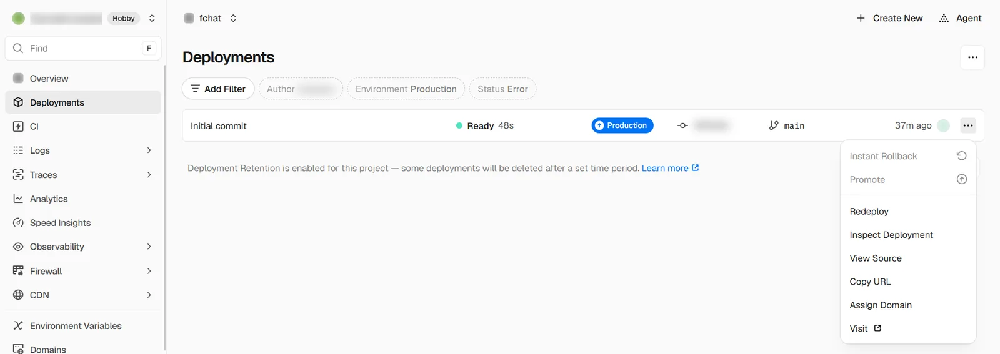

3. In the **Redeploy** window, keep **Production** under "Choose Environment". "Use existing Build Cache." can stay as it is. Click **Redeploy**.

   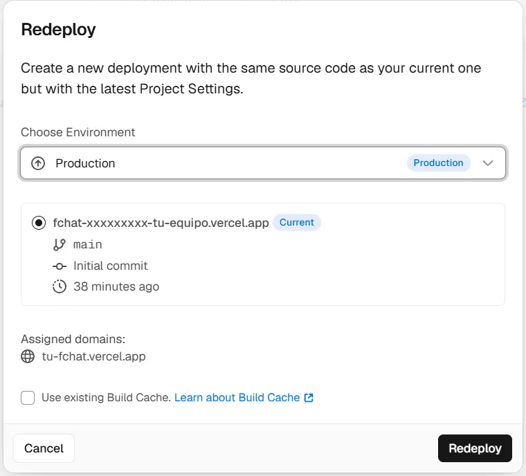

4. A new row appears at the top of **Deployments**. In a minute or two it says **Ready**, and from then on FChat uses the new variables.

Every FChat update adds a row too. The top one, with the blue **Production** label, is the live one:

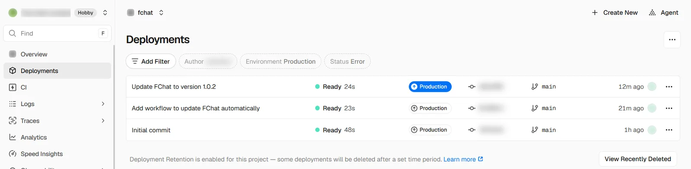

In each row's **...** menu, **Instant Rollback** goes back to a previous deploy if an update causes trouble. With a single deploy it is grayed out. It only rolls back the code: the database stays as it is.

The notice "Deployment Retention is enabled for this project" is normal: Vercel deletes old deploys over time, never the current one.

### Your address and a custom domain

**Domains** shows your FChat address. If you have your own domain and want to use it, click **Add Existing** and follow Vercel's steps to connect it. Then:

1. [Redeploy](#redeploy).
2. Open FChat with the new address and check that the Copy buttons in **Connect your accounts** show it. If they still show the old address, set `PUBLIC_URL` to the new one, like `https://fchat.yourdomain.com`, and redeploy.
3. In Meta, change the webhook URL and the redirect URL to the new ones, as in [docs/meta-setup.md](docs/meta-setup.md).

## Troubleshooting

| What happens | What to check |
| --- | --- |
| No message arrives after commenting | Comment from **another account**. The automation must say **Active** and be set on that post. The Meta app must be **Published** and the webhook verified. |
| The first message arrives but the button does nothing | In Meta, **messaging_postbacks** must be **Subscribed**. In Instagram, **Allow access to messages** must be on. |
| Meta answers "API access blocked" | In Meta, check **Required actions** and the notifications bell and complete what it asks. It usually clears up in a few hours. |
| The webhook does not verify | Use the address under **Domains** with `/webhook` at the end, not a deploy's long address. The token must be identical to the one in FChat. See [Which address to use](#which-address-to-use). |
| Opening FChat shows "Log in to Vercel" | You opened a deploy's long address. Use the one under **Domains**, like `your-fchat.vercel.app`. |
| "Connect Instagram" fails | You pasted the **Instagram** app ID, not the Meta one, and saved the redirect URL in Meta. As a fallback, connect with a token. |
| It asks people to follow even though they already do | Have them tap **Following** again. If it never recognizes them, change **Times to ask** to a number. |
| The setup screen is gone and you did not create the account | Recover access as in [If you forget your password](#if-you-forget-your-password). |

Each case is explained in more detail in [docs/meta-setup.md](docs/meta-setup.md#troubleshooting). In Vercel › your project › **Logs** you can see every notification from Meta and every error: see [View the logs](#view-the-logs).

## If you forget your password

In Vercel › your project › **Environment Variables**, add two variables, as in [Add or change a variable](#add-or-change-a-variable):

- `OWNER_EMAIL`, of type **Config**: the same email you created your account with.
- `OWNER_PASSWORD`, of type **Secret**: a new password of 12 characters or more. If it is shorter, FChat does not apply it and says so in **Logs**.

Then [redeploy](#redeploy). On startup, FChat sets that password and signs out every open session. Log in with your email and the new password.

While those two variables are set, the password can only be changed from Vercel. If you delete them, you can change it again from **Settings** › **Security**.

## Environment variables

All of them are optional. They are for people who prefer to configure FChat from Vercel instead of the dashboard. How to set them is in [Add or change a variable](#add-or-change-a-variable).

| Variable | Purpose |
| --- | --- |
| `DATABASE_URL` | The Postgres database. The Neon database sets it for you |
| `OWNER_EMAIL` and `OWNER_PASSWORD` | Create or recover the administrator account without the setup screen |
| `IG_APP_ID` and `IG_APP_SECRET` | Your Meta app details, if you do not want to paste them in the dashboard |
| `WEBHOOK_VERIFY_TOKEN` | The webhook verify token. Without it, FChat generates one and shows it in the guide |
| `SESSION_SECRET` | Signs sessions. Without it, one is generated and stored in the database |
| `TOKEN_ENC_KEY` | Encrypts Instagram access: 32 bytes in base64. Without it, one is generated and stored in the database |
| `CRON_SECRET` | Protects `/api/cron`, the daily task that renews Instagram access |
| `PUBLIC_URL` | The dashboard address, only if you use a custom domain. On Vercel it is detected automatically |
| `IG_ACCESS_TOKEN` | Connect Instagram with a token generated in Meta, without the "Connect Instagram" button |
| `IG_API_VERSION` | Instagram API version. Defaults to `v26.0` |

If you set `TOKEN_ENC_KEY` after connecting Instagram, or change it, you need to connect the account again and paste your app secret again. Every variable is explained in [.env.example](.env.example).

## Run it on your computer, on Windows or Mac

You do not need this to use FChat: the Vercel installation is the recommended one. This is for trying out code changes.

You need [Node.js](https://nodejs.org) 20.9 or newer, ideally the LTS version, and [Git](https://git-scm.com).

**On Windows**, install Node.js and Git with their installers, open **PowerShell** and run:

```powershell
git clone https://github.com/paidbyfacu/fchat.git
cd fchat
npm install
copy .env.example .env.local
notepad .env.local
```

In `.env.local`, set `PGLITE_DIR` to a folder outside the project, for example `C:/fchat-data`, and save.

**On Mac**, install Node.js with its installer and Git with `xcode-select --install`. Open **Terminal** and run:

```bash
git clone https://github.com/paidbyfacu/fchat.git
cd fchat
npm install
cp .env.example .env.local
open -e .env.local
```

In `.env.local`, set `PGLITE_DIR` to a folder outside the project, for example `/Users/your-username/fchat-data`, and save.

Then, on both systems:

```bash
npm run dev     # dashboard at http://localhost:3000
npm test        # tests
```

Open `http://localhost:3000` and the same setup screen appears. The local database is stored in `PGLITE_DIR`.

For Meta to reach your computer you need a public address. One option is a Cloudflare tunnel: install `cloudflared` with `winget install --id Cloudflare.cloudflared` on Windows or `brew install cloudflared` on Mac, run `cloudflared tunnel --url http://localhost:3000` and put the address it gives you in `PUBLIC_URL`. That address changes every time you start it: update it in `PUBLIC_URL` and in the Meta webhook.

To update, run `git pull` and `npm install` in the FChat folder and start it again.

## How it works

- **Next.js 16** with the App Router, running on Vercel functions. There is no server running all day.
- The webhook stores every notification from Meta, answers right away and processes it in the same function.
- A daily task at `/api/cron` resumes pending retries and renews Instagram access, which lasts 60 days.
- **Postgres** in production and **PGlite** on your computer. Migrations live in `db/migrations` and run on startup.
- The automation engine is in `src/server/engine`, and the update workflow in `.github/workflows/actualizar-fchat.yml`.
- The version comes from `version` in `package.json`: every installation compares it with this repository's to tell you when there is a new one.

## Security

- Everyone installs their own copy: your data and your access stay in your Vercel and your database.
- Instagram access and your app secret are stored encrypted and never reach the browser.
- Signing out, closing a session from **Settings** › **Security** or changing the password revokes that session even if someone copied the cookie.
- After 5 wrong passwords, that IP is blocked for 15 minutes. The limit uses the IP reported by Vercel: if you host it elsewhere, review `clientIp` in `src/server/session.ts`.
- Every notification from Meta is verified with your app secret's signature.
- Create your administrator account as soon as the deploy finishes: until then, anyone who opens the address can create it. If the setup screen is gone when you open your FChat and it was not you, recover access with `OWNER_EMAIL` and `OWNER_PASSWORD` as in [If you forget your password](#if-you-forget-your-password).
- **Turn on two-factor authentication in Vercel, GitHub and Meta.** Anyone who gets into your Vercel can see every variable.
- Never share your Meta app secret or your Instagram token. If you exposed them by mistake, reset the secret in Meta or create a new app, and paste it again in FChat.

Found a vulnerability? Please report it privately, as explained in [SECURITY.md](SECURITY.md), before making it public.

## Contributing

**Pull requests are welcome.** Bug fixes, new features, translations, docs and screenshots all help.

Every accepted change is released as a new version of FChat, and every installation with automatic updates turned on picks it up within a few hours. Your contribution reaches every person who runs FChat, without them doing anything.

Start with [CONTRIBUTING.md](CONTRIBUTING.md): how to run FChat locally, the checks to run before opening a PR and the project conventions. Please follow the [Code of Conduct](CODE_OF_CONDUCT.md). Ideas and bug reports go in [Issues](https://github.com/paidbyfacu/fchat/issues).

## Fair use

- FChat follows Meta's rules: one private reply per comment, within 7 days, and the 24-hour window to continue the conversation.
- Instagram punishes spam, not the tool: vary your texts, do not message people who did not interact, and avoid emoji-only replies.
- It works for your own accounts. To manage other people's accounts, Meta requires reviewing your app through App Review.

## Disclaimer and terms

FChat is an independent project. It is not affiliated with or endorsed by Meta, Instagram, TikTok or ManyChat. Everyone who installs it is responsible for using it according to each platform's policies and the laws of their country. FChat and paidbyfacu are not responsible for blocks, suspensions or bans of accounts, or for misuse of the platform.

The full terms of use are in [TERMS.md](TERMS.md). They are accepted during setup and also live at `/terminos` in your dashboard.

The `/privacy` page that ships with every installation is a starting point: review it and adapt it to your case.

## License

FChat is released under the **[MIT license with the Commons Clause condition](LICENSE)**.

| You can | You cannot |
| --- | --- |
| Use it for free, for your own accounts and for your business | Sell or resell the software or a modified copy of it |
| Change the code and share your changes for free | Offer FChat as a paid service to third parties |
| Run as many installations as you need for yourself or your company | Charge for installing, hosting or supporting it when the main value of what you charge for is FChat |
| Contribute improvements back to this repository | Use the FChat or paidbyfacu names and logos for your own product |

**Why "Other" on GitHub?** GitHub only recognizes standard licenses, and MIT plus Commons Clause is not one of them, so the repository sidebar shows "Other". The text in [LICENSE](LICENSE) is what applies. Because of the no-sale condition, FChat is source-available rather than open source under the OSI definition: the code is open for everyone to read, use and improve, but not to resell.

The FChat and paidbyfacu names and logos are reserved. The logo and banner files in [docs/brand](docs/brand) can be used to link to or talk about this project.

If FChat helps you, tell me on Instagram: [@paidbyfacu](https://instagram.com/paidbyfacu).
