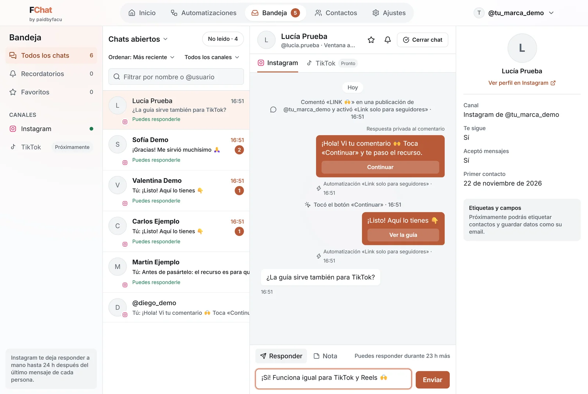
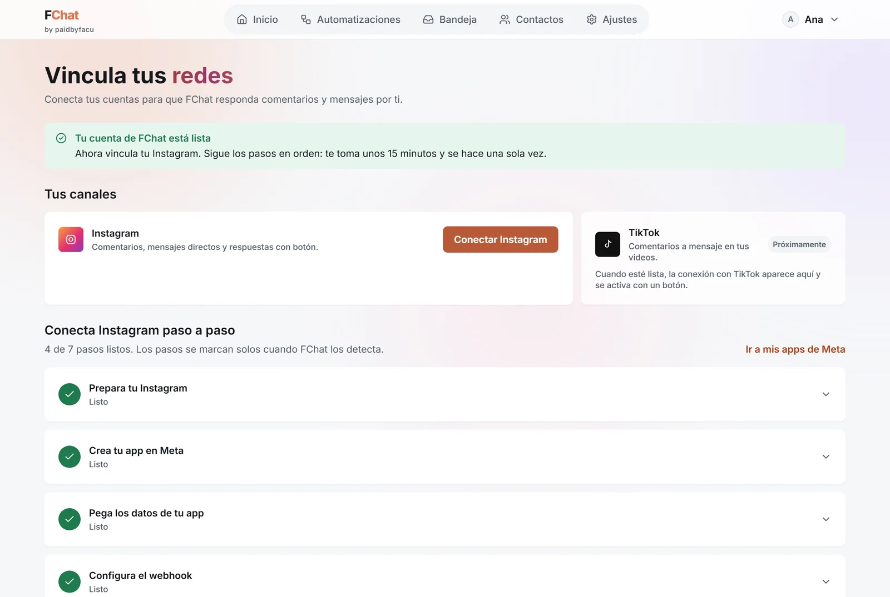
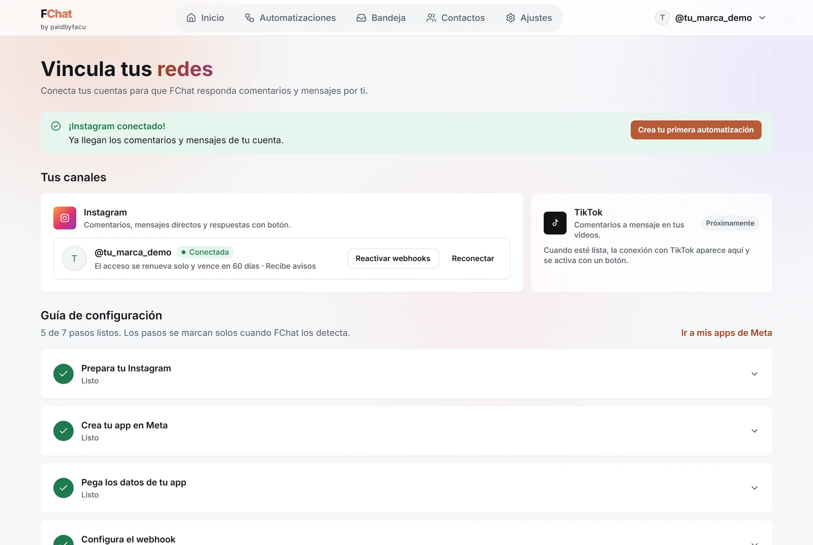
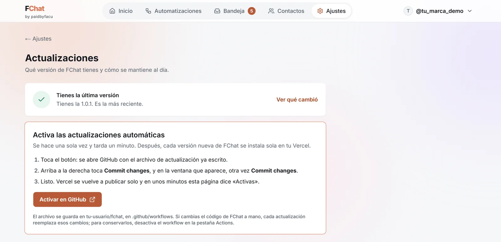
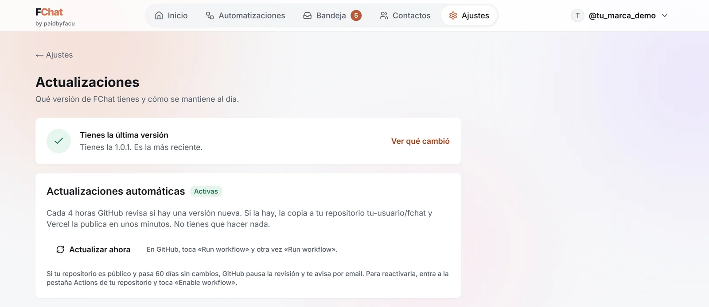
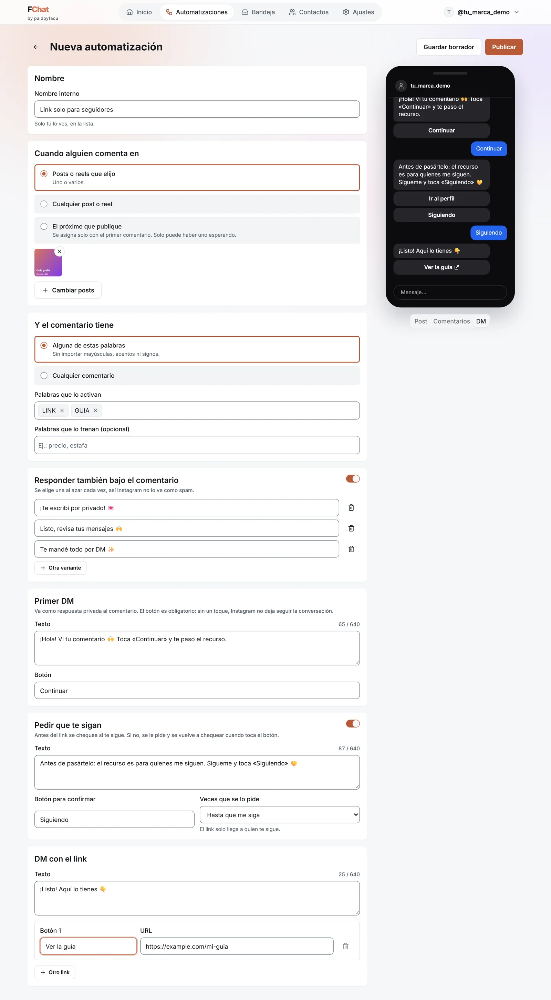
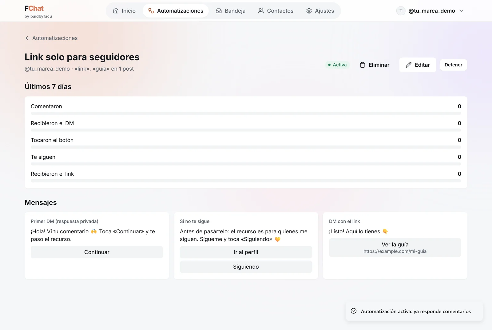
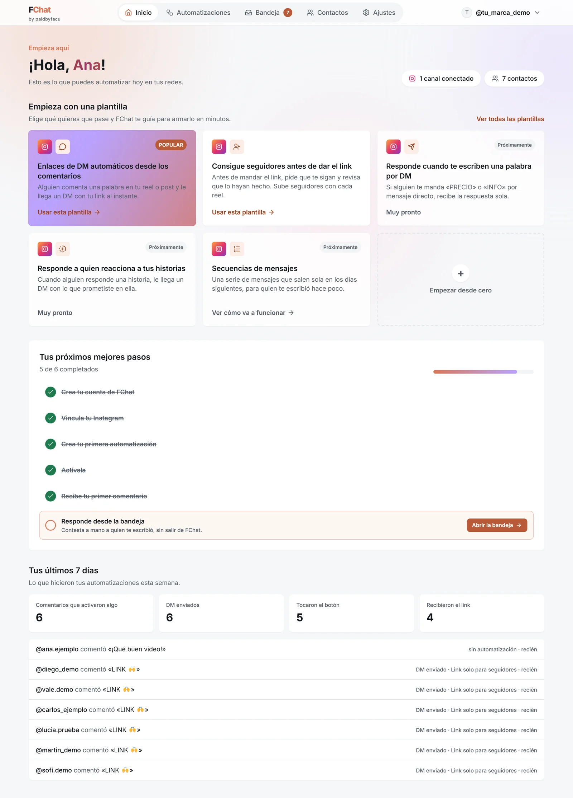
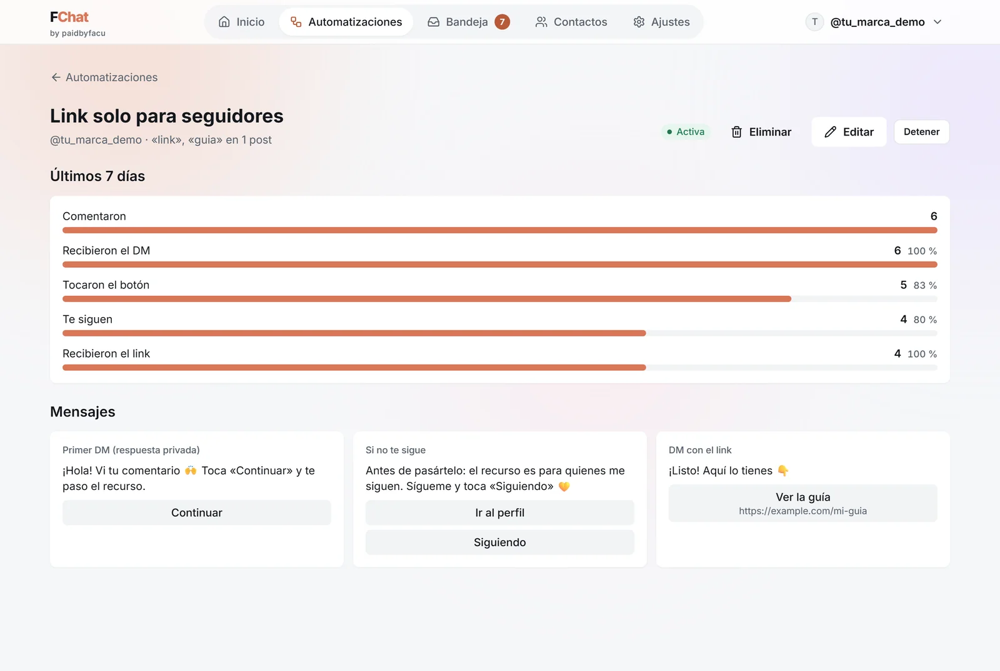
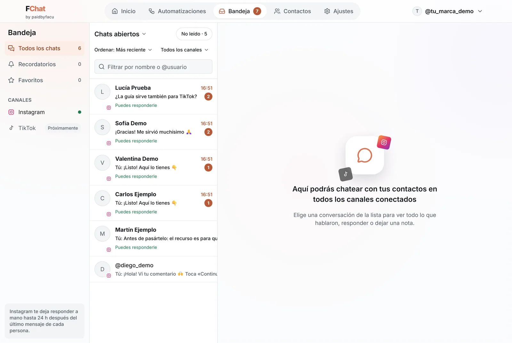

# FChat by paidbyfacu

Automatizaciones de Instagram gratis y de código abierto. Alguien comenta una palabra en tu reel, le llega un mensaje directo con un botón, le pides que te siga y, cuando te sigue, recibe tu link.

Lo instalas en tu propia cuenta de Vercel, con tu propia app de Meta. No pagas una suscripción, nadie más ve tus datos y se actualiza solo.

[](https://vercel.com/new/clone?repository-url=https%3A%2F%2Fgithub.com%2Fpaidbyfacu%2Ffchat&project-name=fchat&repository-name=fchat&stores=%5B%7B%22type%22%3A%22integration%22%2C%22integrationSlug%22%3A%22neon%22%2C%22productSlug%22%3A%22neon%22%2C%22protocol%22%3A%22storage%22%7D%5D)



## Contenido

- [Qué hace](#qué-hace)
- [Qué necesitas](#qué-necesitas)
- [Instalación paso a paso](#instalación-paso-a-paso)
  1. [Prepara tu Instagram](#paso-1-prepara-tu-instagram)
  2. [Instala FChat en Vercel](#paso-2-instala-fchat-en-vercel)
  3. [Crea tu cuenta de administrador](#paso-3-crea-tu-cuenta-de-administrador)
  4. [Conecta Instagram con Meta](#paso-4-conecta-instagram-con-meta)
  5. [Activa las actualizaciones automáticas](#paso-5-activa-las-actualizaciones-automáticas)
  6. [Crea tu primera automatización](#paso-6-crea-tu-primera-automatización)
  7. [Pruébala](#paso-7-pruébala)
- [Cómo se usa](#cómo-se-usa)
- [Si algo no funciona](#si-algo-no-funciona)
- [Si olvidas tu contraseña](#si-olvidas-tu-contraseña)
- [Variables de entorno](#variables-de-entorno)
- [Correrlo en tu computadora, en Windows o Mac](#correrlo-en-tu-computadora-en-windows-o-mac)
- [Cómo funciona por dentro](#cómo-funciona-por-dentro)
- [Seguridad](#seguridad)
- [Buen uso](#buen-uso)
- [Aviso](#aviso)
- [Licencia](#licencia)

## Qué hace

- **Comentario a DM.** Cuando alguien comenta una palabra clave, recibe un mensaje privado al instante. La palabra se reconoce igual con mayúsculas, minúsculas, con acento o sin acento.
- **En un post, en varios o en todos.** Eliges uno o varios posts o reels, cualquier post de la cuenta o el próximo que publiques.
- **Pedir que te sigan.** Antes de entregar el link, la app revisa si la persona te sigue. Si no, le pide que te siga y le muestra un botón «Siguiendo». Puedes exigir que te siga sí o sí, o pedírselo una cantidad de veces y después mandarle el link igual.
- **Respuesta pública bajo el comentario.** Hasta 10 variantes que se eligen al azar, para que Instagram no lo tome como spam.
- **Bandeja.** Todas tus conversaciones en un solo lugar: abiertas, cerradas, no leídas y favoritas, con recordatorios, notas internas y respuestas tuyas desde el panel.
- **Plantillas.** Eliges una plantilla, cambias la palabra y el link, y la activas.
- **Estadísticas.** Cuántos comentaron, cuántos recibieron el mensaje, tocaron el botón, te siguieron y recibieron el link.
- **Reintentos.** Si Instagram limita un envío, la app lo vuelve a intentar más tarde en el mismo paso, sin repetir mensajes.
- **Actualizaciones automáticas.** Cada versión nueva llega sola a tu Vercel.

Usa solo la API oficial de Instagram de Meta: la misma que usan las herramientas pagas. No entra con tu usuario y contraseña de Instagram ni simula a una persona. TikTok y las secuencias de mensajes llegan en una próxima versión.

## Qué necesitas

- Una cuenta de Instagram **profesional**, de empresa o de creador. Se cambia gratis desde la app de Instagram.
- Una **segunda cuenta de Instagram** para probar: tuya o de alguien de confianza.
- Una cuenta de [GitHub](https://github.com) y una de [Vercel](https://vercel.com). El plan gratis de Vercel alcanza. Puedes crear la de Vercel con tu cuenta de GitHub.
- Una cuenta de Facebook para entrar a [Meta for Developers](https://developers.facebook.com). La cuenta de desarrollador es gratis y se crea durante la guía.

No necesitas instalar nada en tu computadora ni escribir código. Todo se hace desde el navegador, así que los pasos son los mismos en **Windows** y en **Mac**. Chrome, Edge, Safari o Firefox sirven igual.

## Instalación paso a paso

Son unos 30 minutos en total y se hace una sola vez. Los paneles de Meta y de Vercel cambian seguido: si un botón tiene otro nombre, busca el más parecido.

### Paso 1. Prepara tu Instagram

En la app de Instagram del teléfono, con la cuenta que quieres automatizar:

1. Pásala a **profesional**: **Configuración** › **Tipo de cuenta y herramientas** › **Cambiar a cuenta profesional**. Elige empresa o creador.
2. Permite el acceso a los mensajes: **Configuración** › **Mensajes y respuestas a historias** › **Controles de mensajes** › **Herramientas conectadas** › activa **Permitir acceso a los mensajes**.

### Paso 2. Instala FChat en Vercel

1. Toca el botón **Instalar en Vercel** de arriba y entra a Vercel con tu cuenta de GitHub.
2. Vercel te pide un nombre para tu repositorio: deja «fchat» o elige otro. Puede ser privado. Toca **Create**.
3. Cuando te ofrezca la base de datos de **Neon**, acéptala: elige la región más cercana a ti y el plan gratis. Ahí se guardan tus automatizaciones y contactos.
4. Espera a que termine el deploy, unos 3 minutos. Vercel muestra una vista previa de tu FChat: toca **Continue to Dashboard**.
5. En el panel de tu proyecto, toca **Visit** para abrir tu FChat. Su dirección es algo como `https://fchat-tu-usuario.vercel.app`. Guárdala en tus favoritos.

No hace falta cargar variables de entorno: los secretos se generan solos la primera vez que abres FChat.

### Paso 3. Crea tu cuenta de administrador

Abre tu FChat **apenas termine el deploy**. Aparece la pantalla de instalación:


1. Escribe tu nombre, tu email y una contraseña de 12 caracteres o más.
2. Lee y acepta los términos de uso.
3. Toca **Crear mi cuenta**.

Esa cuenta es la única que entra al panel. Después de crearla, la pantalla de instalación ya no aparece.

### Paso 4. Conecta Instagram con Meta

Al crear la cuenta, FChat te lleva a **Vincula tus redes**: una guía de 7 pasos dentro del panel, con botones para copiar cada dato que pide Meta. Cada paso se marca solo cuando FChat detecta que lo hiciste.



1. Preparar tu Instagram.
2. Crear tu app en Meta.
3. Pegar en FChat el identificador y la clave de tu app.
4. Configurar el webhook.
5. Conectar tu cuenta de Instagram.
6. Publicar tu app de Meta.
7. Crear tu primera automatización y probarla.

**La guía completa, con una captura de cada pantalla de Meta, está en [docs/configurar-meta.md](docs/configurar-meta.md).** Síguela con FChat abierto en una pestaña y Meta en otra. Tarda unos 15 minutos.


Cuando termines, FChat muestra «¡Instagram conectado!» y tu cuenta aparece como **Conectada**:



### Paso 5. Activa las actualizaciones automáticas

En FChat: **Ajustes** › **Actualizaciones** › **Activar en GitHub**.



1. Se abre GitHub con el archivo de actualización ya escrito. Arriba a la derecha toca **Commit changes**.
2. En la ventana que aparece, toca otra vez **Commit changes**.
3. Vercel se vuelve a publicar solo. En unos minutos, la página de FChat dice **Activas**.



Desde ahí, cada 4 horas GitHub revisa si hay una versión nueva de FChat. Si la hay, la copia a tu repositorio y Vercel la publica sola en unos minutos. Tus datos no se tocan: viven en la base de datos, no en el código. Si quieres actualizar en el momento, toca **Actualizar ahora**.

El botón de Vercel no copia la carpeta `.github` del repositorio. Por eso este paso se hace desde el panel.

### Paso 6. Crea tu primera automatización

1. En FChat: **Automatizaciones** › **Plantillas**. Elige **Enlaces de DM automáticos desde los comentarios**, o **Consigue seguidores antes de dar el link** si quieres que te sigan antes de recibirlo.

   

2. Completa el asistente. A la derecha, la vista previa del teléfono muestra cómo lo va a ver la persona:
   - **Nombre:** solo lo ves tú, en la lista.
   - **Cuando alguien comenta en:** posts o reels que eliges, cualquier post o reel, o el próximo que publiques. Toca **Elegir posts** y marca uno o varios.
   - **Y el comentario tiene:** las palabras que lo activan, por ejemplo `LINK`. Escribe cada una y toca Enter. También puedes poner palabras que lo frenan.
   - **Responder también bajo el comentario:** las respuestas públicas, por ejemplo «¡Te escribí por privado!». Se elige una al azar cada vez.
   - **Primer DM:** el mensaje privado con su botón, por ejemplo «Continuar». El botón es obligatorio: sin un toque, Instagram no deja seguir la conversación.
   - **Pedir que te sigan:** el mensaje para quien no te sigue y cuántas veces se lo pide. Con **Hasta que me siga**, el link solo llega a quien te sigue.
   - **DM con el link:** el mensaje final, con el texto del botón y tu link.

   

   

3. Toca **Publicar**. Aparece el aviso «Automatización activa: ya responde comentarios».

   

Si prefieres dejarla para después, toca **Guardar borrador**.

### Paso 7. Pruébala

1. Desde tu **segunda cuenta** de Instagram, comenta la palabra en el post que elegiste, por ejemplo `link`. Los comentarios de tu propia cuenta no disparan nada.
2. A la segunda cuenta le llega el mensaje con el botón. Tócalo.
3. Si elegiste pedir que te sigan y esa cuenta no te sigue, le llega el pedido con el botón **Siguiendo**. Que te siga y lo toque.
4. Le llega el link. La conversación aparece en la **Bandeja** de FChat y los números, en la automatización.

Si no llega nada, mira [Si algo no funciona](#si-algo-no-funciona).

## Cómo se usa

### Inicio

Lo primero que ves al entrar: plantillas para empezar, los próximos pasos que te faltan y los números de los últimos 7 días.



### Automatizaciones y estadísticas

En **Automatizaciones** ves todas las tuyas, activas y en borrador. Al abrir una, ves cuántas personas pasaron por cada paso en los últimos 7 días y los mensajes que manda. Desde ahí la editas, la detienes o la eliminas.




### Bandeja

Todas tus conversaciones de Instagram. Filtra por abiertas, cerradas, no leídas o favoritas, y pon recordatorios. Al abrir una conversación ves el comentario, cada mensaje que mandó la automatización y lo que tocó la persona. A la derecha, sus datos y si te sigue. Puedes responderle a mano y dejar notas internas que solo ves tú.



Instagram te deja responder a mano hasta 24 horas después del último mensaje de cada persona.

### Contactos

Todas las personas que interactuaron con tus automatizaciones: si te siguen, si tocaron un botón y si su ventana de 24 horas está abierta.


### Ajustes

- **Redes conectadas:** tu cuenta de Instagram, para reconectarla o reactivar los webhooks.
- **Seguridad:** tu contraseña y las sesiones abiertas, que puedes cerrar desde ahí.
- **Actualizaciones:** la versión de FChat que tienes y las actualizaciones automáticas.
- **Términos y licencia:** lo que aceptaste al instalar.

## Si algo no funciona

| Qué pasa | Qué revisar |
| --- | --- |
| No llega el mensaje al comentar | Comenta desde **otra cuenta**. La automatización tiene que decir **Activa** y estar en ese post. La app de Meta tiene que estar **Publicada** y el webhook verificado. |
| Llega el primer mensaje pero el botón no hace nada | En Meta, **messaging_postbacks** tiene que estar en **Suscritos**. En Instagram, **Permitir acceso a los mensajes** tiene que estar activo. |
| Meta responde «API access blocked» | En Meta, revisa **Acciones requeridas** y la campana de avisos y completa lo que pida. Suele resolverse en unas horas. |
| El webhook no verifica | La dirección termina en `/webhook` y el token es idéntico al de FChat. |
| «Conectar Instagram» da error | Pegaste el identificador de la app **de Instagram**, no el de Meta, y guardaste la URL de redireccionamiento en Meta. Como respaldo, conéctalo con un token. |
| Le pide que te siga aunque ya te sigue | Que toque **Siguiendo** otra vez. Si nunca lo reconoce, cambia **Veces que se lo pide** a un número. |
| La pantalla de instalación ya no aparece y no creaste la cuenta | Recupera el acceso como en [Si olvidas tu contraseña](#si-olvidas-tu-contraseña). |

Cada caso está explicado con más detalle en [docs/configurar-meta.md](docs/configurar-meta.md#si-algo-no-funciona). En Vercel › tu proyecto › **Logs** ves cada aviso que llega de Meta y cada error.

## Si olvidas tu contraseña

En Vercel › tu proyecto › **Settings** › **Environment Variables**, agrega `OWNER_EMAIL` con tu email y `OWNER_PASSWORD` con una contraseña nueva de 12 caracteres o más. Después ve a **Deployments** y vuelve a desplegar el último. Al arrancar, FChat pone esa contraseña y cierra todas las sesiones abiertas.

Mientras esas dos variables estén cargadas, la contraseña se cambia solo desde Vercel. Si las borras, vuelves a cambiarla desde **Ajustes** › **Seguridad**.

## Variables de entorno

Todas son opcionales. Sirven para quien prefiere configurar FChat desde Vercel en lugar de desde el panel.

| Variable | Para qué |
| --- | --- |
| `DATABASE_URL` | La base Postgres. La pone sola la base de Neon |
| `OWNER_EMAIL` y `OWNER_PASSWORD` | Crear o recuperar la cuenta de administrador sin la pantalla de instalación |
| `IG_APP_ID` y `IG_APP_SECRET` | Los datos de tu app de Meta, si no quieres pegarlos en el panel |
| `WEBHOOK_VERIFY_TOKEN` | El token de verificación del webhook. Sin ella, FChat genera uno y lo muestra en la guía |
| `SESSION_SECRET` | Firma las sesiones. Sin ella, se genera una y se guarda en la base |
| `TOKEN_ENC_KEY` | Cifra los accesos a Instagram: 32 bytes en base64. Sin ella, se genera una y se guarda en la base |
| `CRON_SECRET` | Protege `/api/cron`, la tarea diaria que renueva el acceso a Instagram |
| `PUBLIC_URL` | La dirección del panel, solo si usas un dominio propio. En Vercel se detecta sola |
| `IG_ACCESS_TOKEN` | Conectar Instagram con un token generado en Meta, sin el botón «Conectar Instagram» |
| `IG_API_VERSION` | Versión de la API de Instagram. Por defecto `v26.0` |

Si cargas `TOKEN_ENC_KEY` después de haber conectado Instagram, o la cambias, hay que volver a conectar la cuenta y volver a pegar la clave de tu app. Cada variable está explicada en [.env.example](.env.example).

## Correrlo en tu computadora, en Windows o Mac

Para usar FChat no hace falta: la instalación en Vercel es la recomendada. Esto sirve para probar cambios en el código.

Necesitas [Node.js](https://nodejs.org) 20 o más nuevo, mejor la versión LTS, y [Git](https://git-scm.com).

**En Windows**, instala Node.js y Git con sus instaladores, abre **PowerShell** y corre:

```powershell
git clone https://github.com/paidbyfacu/fchat.git
cd fchat
npm install
copy .env.example .env.local
notepad .env.local
```

En `.env.local`, completa `PGLITE_DIR` con una carpeta fuera del proyecto, por ejemplo `C:/fchat-data`, y guarda.

**En Mac**, instala Node.js con su instalador y Git con `xcode-select --install`. Abre **Terminal** y corre:

```bash
git clone https://github.com/paidbyfacu/fchat.git
cd fchat
npm install
cp .env.example .env.local
open -e .env.local
```

En `.env.local`, completa `PGLITE_DIR` con una carpeta fuera del proyecto, por ejemplo `/Users/tu-usuario/fchat-data`, y guarda.

Después, en los dos sistemas:

```bash
npm run dev     # panel en http://localhost:3000
npm test        # pruebas
```

Abre `http://localhost:3000` y aparece la misma pantalla de instalación. La base local se guarda en `PGLITE_DIR`.

Para que Meta llegue a tu computadora necesitas una dirección pública. Una opción es un túnel de Cloudflare: instala `cloudflared` con `winget install --id Cloudflare.cloudflared` en Windows o `brew install cloudflared` en Mac, corre `cloudflared tunnel --url http://localhost:3000` y pon la dirección que te da en `PUBLIC_URL`. Esa dirección cambia cada vez que lo arrancas: hay que actualizarla en `PUBLIC_URL` y en el webhook de Meta.

Para actualizar, en la carpeta de FChat corre `git pull` y `npm install`, y vuelve a arrancarlo.

## Cómo funciona por dentro

- **Next.js 16** con App Router, en funciones de Vercel. No hay un servidor prendido todo el día.
- El webhook guarda cada aviso de Meta, responde enseguida y lo procesa en la misma función.
- Una tarea diaria en `/api/cron` retoma reintentos pendientes y renueva el acceso a Instagram, que dura 60 días.
- **Postgres** en producción y **PGlite** en tu computadora. Las migraciones están en `db/migrations` y corren solas al arrancar.
- El motor de automatizaciones está en `src/server/engine`, y el workflow de actualización en `.github/workflows/actualizar-fchat.yml`.
- La versión sale de `version` en `package.json`: cada instalación la compara con la de este repositorio para avisar si hay una nueva.

## Seguridad

- Cada persona instala su propia copia: tus datos y tus accesos quedan en tu Vercel y tu base.
- Los accesos a Instagram y la clave de tu app se guardan cifrados y nunca llegan al navegador.
- Cerrar sesión, cerrar una sesión desde **Ajustes** › **Seguridad** o cambiar la contraseña anula esa sesión aunque alguien haya copiado la cookie.
- Con 5 contraseñas incorrectas, esa IP queda bloqueada 15 minutos. El freno usa la IP que informa Vercel: si lo instalas en otro hosting, revisa `clientIp` en `src/server/session.ts`.
- Cada aviso de Meta se verifica con la firma de la clave secreta de tu app.
- Crea tu cuenta de administrador apenas termine el deploy: hasta ese momento, quien abra la dirección puede crearla. Si al abrir tu FChat ya no aparece la pantalla de instalación y no fuiste tú, recupera el acceso con `OWNER_EMAIL` y `OWNER_PASSWORD` como en «Si olvidas tu contraseña».
- **Activa la verificación en dos pasos en Vercel, GitHub y Meta.** Quien entre a tu Vercel ve todas las variables.
- Nunca compartas la clave secreta de tu app de Meta ni el token de Instagram. Si los mostraste por error, cambia la clave en Meta o crea una app nueva, y pégala otra vez en FChat.

Si encuentras una falla de seguridad, avísame por mensaje privado antes de publicarla.

## Buen uso

- La app cumple las reglas de Meta: una respuesta privada por comentario, dentro de los 7 días, y la ventana de 24 horas para seguir la conversación.
- Instagram castiga el spam, no la herramienta: varía los textos, no mandes mensajes a quien no interactuó y evita respuestas de solo emojis.
- Funciona para tus propias cuentas. Para manejar cuentas de otras personas, Meta pide revisar tu app con su proceso de App Review.

## Aviso

FChat es un proyecto independiente. No está afiliado ni respaldado por Meta, Instagram, TikTok ni ManyChat. Cada persona que lo instala es responsable de usarlo según las políticas de cada plataforma y las leyes de su país. FChat y paidbyfacu no se hacen responsables por bloqueos, suspensiones o baneos de cuentas, ni por el mal uso de la plataforma. Los términos completos se aceptan al instalar y están en `/terminos` de tu panel.

La página `/privacy` que trae cada instalación es un punto de partida: revísala y adáptala a tu caso.

Las capturas de esta guía son de una instalación de prueba con datos inventados.

## Licencia

[MIT con la condición Commons Clause](LICENSE). Puedes usarlo gratis, para tus cuentas y para tu negocio, cambiarlo y compartirlo. **No puedes venderlo ni comercializarlo**: ni cobrar por el software o por una copia modificada, ni ofrecerlo como un servicio pago, ni cobrar por instalarlo o alojarlo cuando lo que vendes es FChat. Los nombres y logos de FChat y paidbyfacu están reservados.

Si te sirvió, cuéntamelo en Instagram: [@paidbyfacu](https://instagram.com/paidbyfacu).
