# Conectar Instagram con Meta, paso a paso

Esta guía arma la app de Meta que conecta FChat con tu Instagram. Es la misma guía de 7 pasos que ves en tu panel, en **Vincula tus redes**, con una captura de cada pantalla de Meta. La app es tuya y gratis: Meta te da acceso a tu propia cuenta sin pasar por App Review.

Tarda unos 15 minutos y se hace una sola vez. Funciona igual en Windows y en Mac: todo pasa en el navegador. Te conviene tener FChat abierto en una pestaña y Meta en otra.

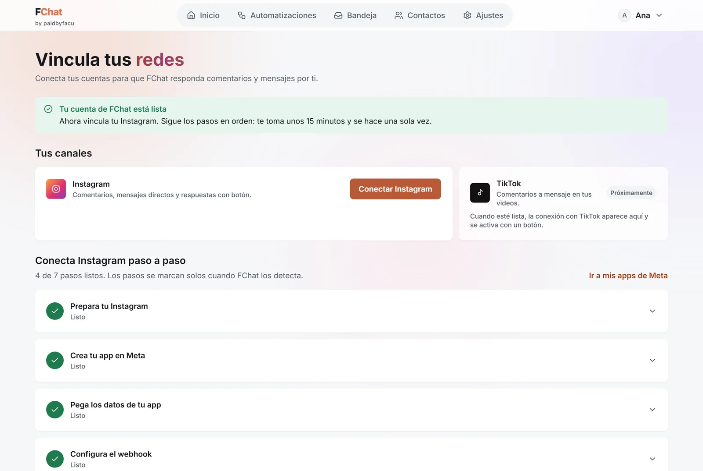

En el panel, cada dato que tienes que pegar en Meta tiene un botón **Copiar** y ya viene con la dirección de tu FChat. En esta guía aparece como `https://tu-fchat.vercel.app`: cámbiala por la tuya. Cada paso se marca solo en FChat cuando detecta que lo hiciste.

Los paneles de Meta cambian seguido. Si un botón tiene otro nombre, busca el más parecido. Las capturas son de noviembre de 2026.

**En esta guía**

1. [Prepara tu Instagram](#1-prepara-tu-instagram)
2. [Crea tu app en Meta](#2-crea-tu-app-en-meta)
3. [Pega los datos de tu app en FChat](#3-pega-los-datos-de-tu-app-en-fchat)
4. [Configura el webhook](#4-configura-el-webhook)
5. [Conecta tu cuenta de Instagram](#5-conecta-tu-cuenta-de-instagram)
6. [Publica tu app](#6-publica-tu-app)
7. [Crea tu primera automatización y pruébala](#7-crea-tu-primera-automatización-y-pruébala)
- [Si algo no funciona](#si-algo-no-funciona)
- [Límites de Instagram que conviene saber](#límites-de-instagram-que-conviene-saber)

## 1. Prepara tu Instagram

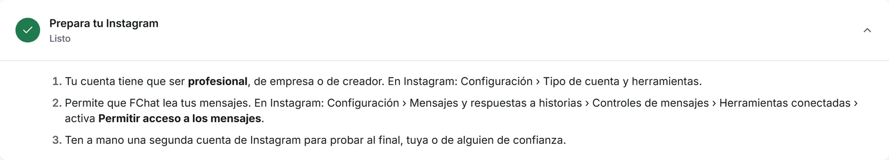

Todo esto se hace en la app de Instagram del teléfono, con tu cuenta:

1. Tu cuenta tiene que ser **profesional**, de empresa o de creador. Se cambia en **Configuración** › **Tipo de cuenta y herramientas** › **Cambiar a cuenta profesional**. Es gratis y no pierdes seguidores.
2. Permite que FChat lea tus mensajes: **Configuración** › **Mensajes y respuestas a historias** › **Controles de mensajes** › **Herramientas conectadas** › activa **Permitir acceso a los mensajes**. Sin esto, Instagram no le avisa a FChat de los mensajes.
3. Ten a mano una **segunda cuenta de Instagram** para probar al final. Puede ser una cuenta tuya secundaria o la de alguien de confianza. Los comentarios de tu propia cuenta no disparan automatizaciones.

## 2. Crea tu app en Meta

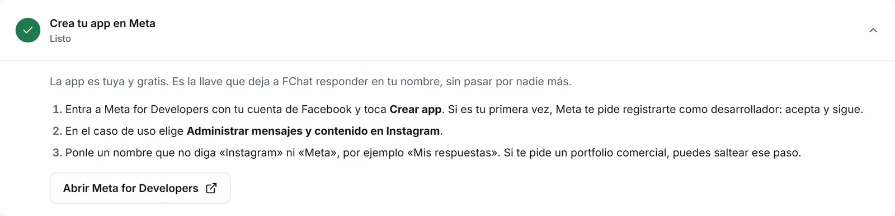

1. Entra a [developers.facebook.com/apps](https://developers.facebook.com/apps/) con tu cuenta de Facebook. Si es la primera vez, Meta te pide registrarte como desarrollador: acepta los términos, confirma tu cuenta con el código que te llega y sigue. Es gratis.
2. En **Apps**, toca **Crear app**.

   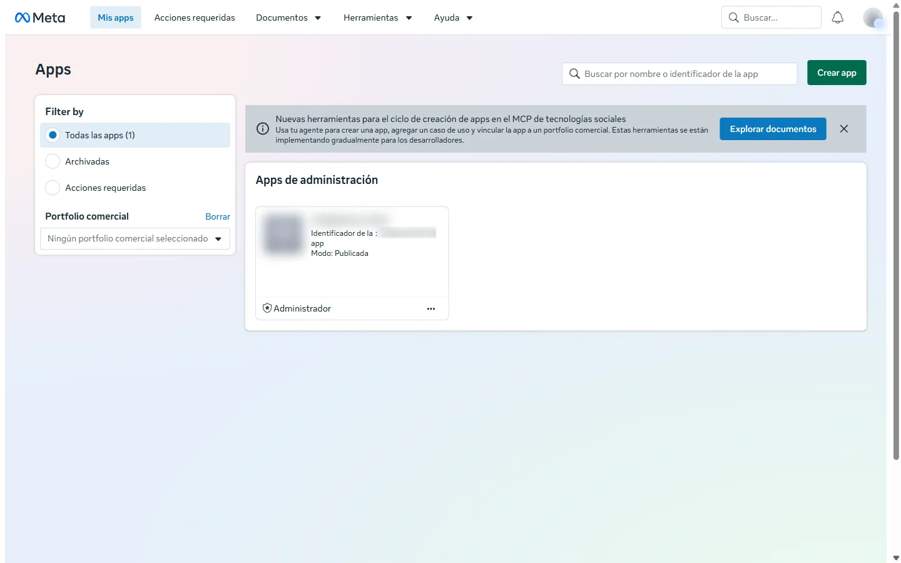

3. **Detalles de la app.** Escribe un nombre que no diga «Instagram» ni «Meta», por ejemplo «Mis respuestas». Meta no acepta nombres con sus marcas. Revisa el email de contacto y toca **Siguiente**.

   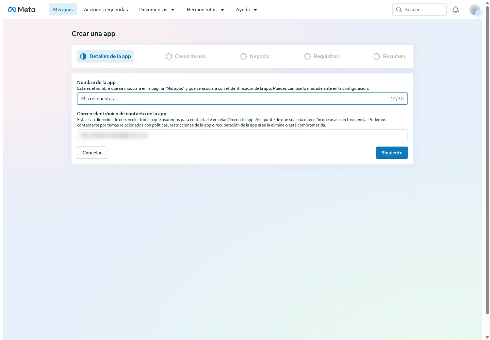

4. **Casos de uso.** El de Instagram no aparece en «Destacados»: en la lista de la izquierda toca **Mensajes comerciales** y marca **Administrar mensajes y contenido en Instagram**. Abajo tiene que decir «1 caso de uso agregado». Toca **Siguiente**.

   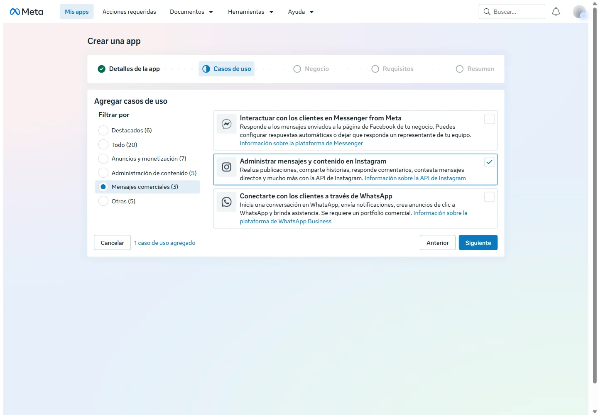

5. **Negocio.** Marca **Aún no quiero conectar un portfolio comercial.** y toca **Siguiente**. Si ya tienes un portfolio de Meta Business, puedes elegirlo: para FChat da igual.

   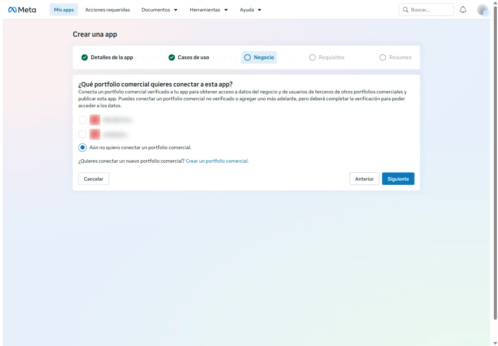

6. **Requisitos.** Tiene que decir «No se identificaron requisitos». Toca **Siguiente**.
7. **Resumen.** Revisa que figure el caso de uso de Instagram y toca **Crear app**. Meta puede pedirte la contraseña de Facebook.

   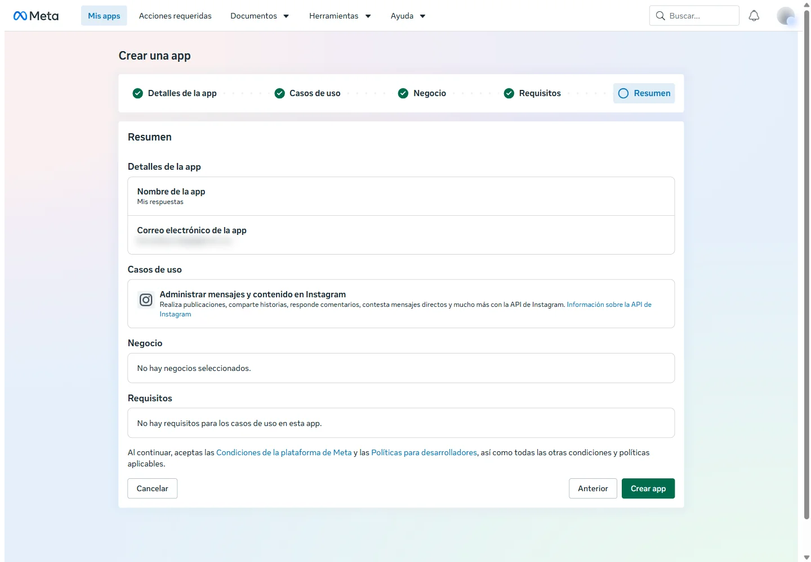

Al terminar llegas al **Panel** de tu app. Abajo, en **Casos de uso en esta app**, toca **Administrar mensajes y contenido en Instagram**: ahí está todo lo de los pasos 3, 4 y 5.

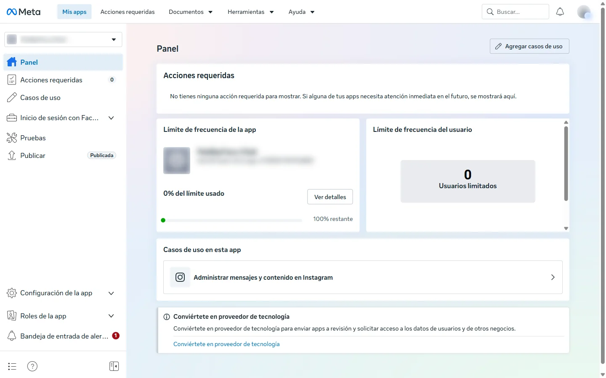

## 3. Pega los datos de tu app en FChat

En Meta llegas a **Casos de uso** › **Personalizar**. Arriba del menú de la izquierda tiene que decir **API de Instagram**. En ese menú, toca **Configuración de la API con inicio de sesión con Instagram**.

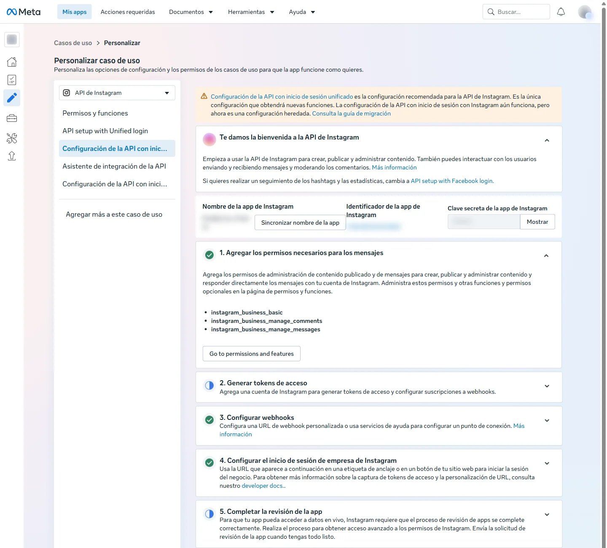

Meta muestra un aviso naranja que recomienda el «inicio de sesión unificado». FChat usa la configuración con inicio de sesión con Instagram, que sigue funcionando: puedes ignorar ese aviso.

Copia estos dos datos de la tarjeta de arriba:

- **Identificador de la app de Instagram**: un número largo.
- **Clave secreta de la app de Instagram**: toca **Mostrar** para verla. Meta puede pedirte la contraseña de Facebook.

Pégalos en FChat, en el paso 3 de **Vincula tus redes**, y toca **Guardar los cambios**. Tiene que aparecer «Guardado. Sigue con el paso siguiente.».

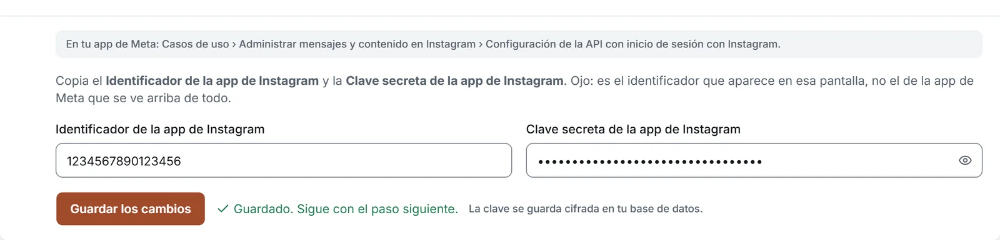

- **Ojo:** es el identificador de la app **de Instagram**, el de esa tarjeta. No es el identificador de la app de Meta que aparece arriba de todo o en Configuración › Básica. Si pegas el otro, el botón «Conectar Instagram» falla.
- La sección **1. Agregar los permisos necesarios para los mensajes** ya trae `instagram_business_basic`, `instagram_business_manage_comments` e `instagram_business_manage_messages`. No hace falta tocar nada.
- FChat guarda la clave cifrada en tu base de datos. Si prefieres, puedes cargar los dos datos en Vercel como `IG_APP_ID` e `IG_APP_SECRET`: las variables tienen prioridad sobre lo que pegues en el panel.

## 4. Configura el webhook

El webhook es la dirección a la que Meta le avisa a FChat cada comentario y cada mensaje.

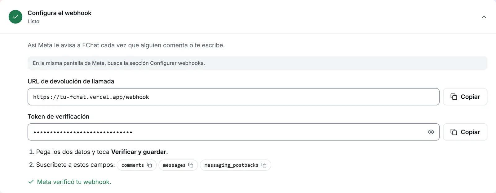

En la misma pantalla de Meta, abre la sección **3. Configurar webhooks**:

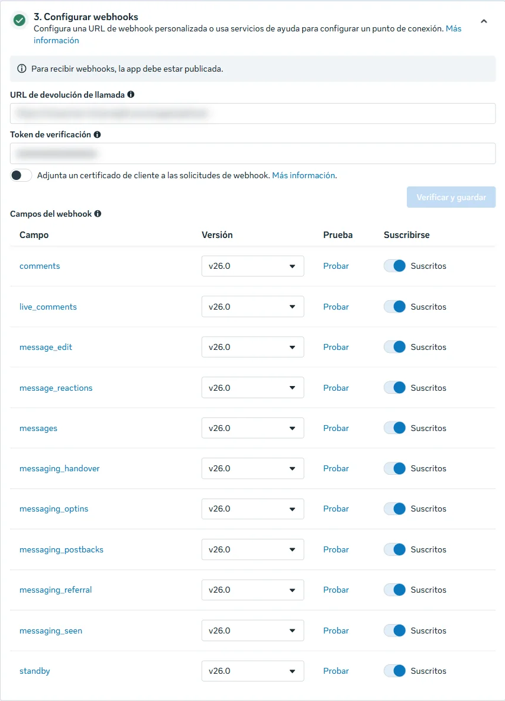

1. **URL de devolución de llamada:** pega la que copiaste de FChat, con este formato: `https://tu-fchat.vercel.app/webhook`.
2. **Token de verificación:** pega el que muestra FChat en el paso 4. Usa el botón **Copiar** para no dejar espacios.
3. Toca **Verificar y guardar**. Cuando Meta lo verifica, en FChat aparece «Meta verificó tu webhook.» y el paso se marca solo.
4. En la tabla de campos de abajo, activa **Suscritos** en **comments**, **messages** y **messaging_postbacks**. El resto puede quedar apagado.

Arriba de esa sección Meta avisa «Para recibir webhooks, la app debe estar publicada». Es normal: la publicas en el paso 6.

Si falla la verificación:

- Revisa que la dirección termine en `/webhook` y no tenga una barra de más.
- Revisa que el token sea idéntico: cópialo otra vez con el botón.
- Abre tu FChat en el navegador: si no carga, Meta tampoco llega.

## 5. Conecta tu cuenta de Instagram

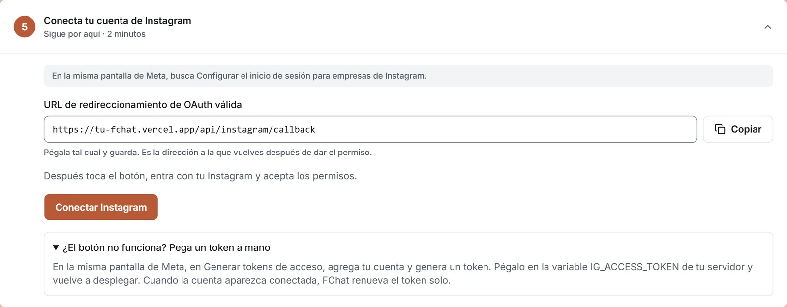

1. En FChat, en el paso 5, copia la **URL de redireccionamiento de OAuth válida**. Tiene este formato: `https://tu-fchat.vercel.app/api/instagram/callback`.
2. En Meta, en la sección **4. Configurar el inicio de sesión de empresa de Instagram**, toca **Configuración de inicio de sesión del negocio**.

   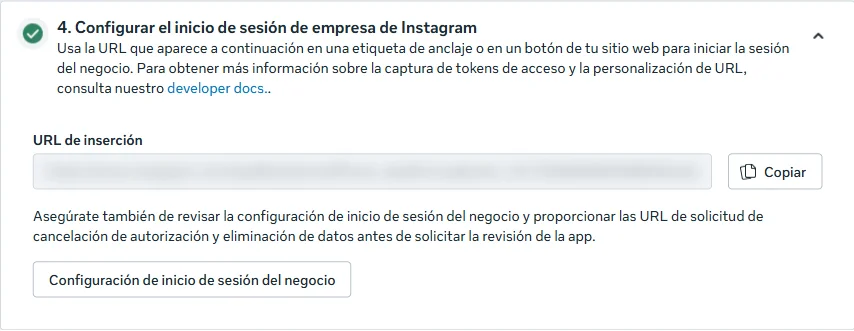

3. En la ventana que se abre, pega la dirección en **URI de redireccionamiento de OAuth** y toca **Guardar**. Los otros dos campos son opcionales.

   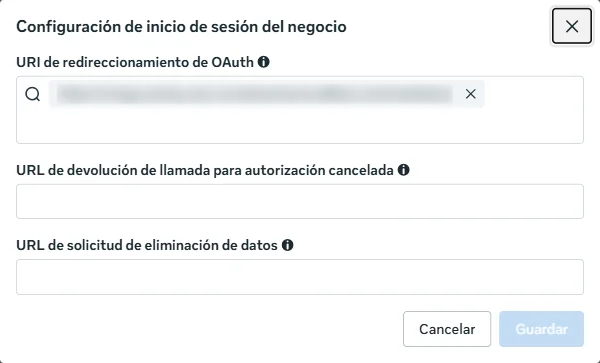

4. Vuelve a FChat y toca **Conectar Instagram**. Entra con la cuenta de Instagram que quieres automatizar y acepta los permisos.

Al volver, FChat muestra «¡Instagram conectado!» y tu cuenta aparece en **Tus canales** como **Conectada**. El acceso dura 60 días y FChat lo renueva solo cada día.

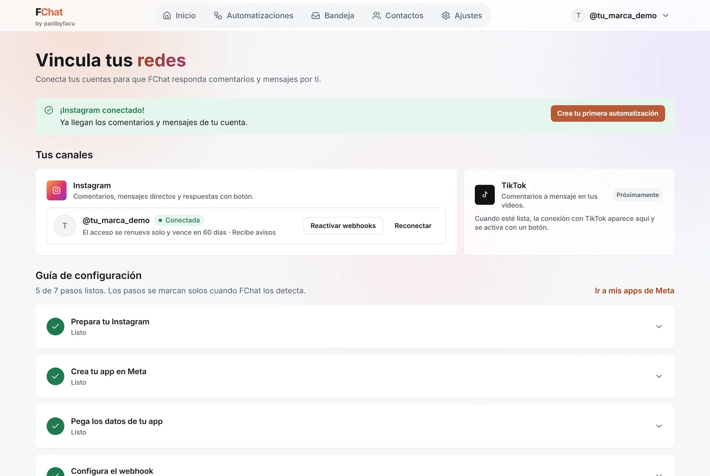

Si en el navegador tienes abierta otra cuenta de Instagram, Instagram conecta esa. Cierra sesión en instagram.com o usa una ventana de incógnito antes de tocar **Conectar Instagram**.

**Si el botón no funciona, conéctalo con un token.** En Meta, en la sección **2. Generar tokens de acceso**, toca **Agregar cuenta** y entra con tu Instagram. Al lado de tu cuenta toca **Generar token** y cópialo. Pégalo en Vercel › tu proyecto › **Settings** › **Environment Variables** como `IG_ACCESS_TOKEN` y vuelve a desplegar desde **Deployments**. FChat lo importa al arrancar y después lo renueva solo.

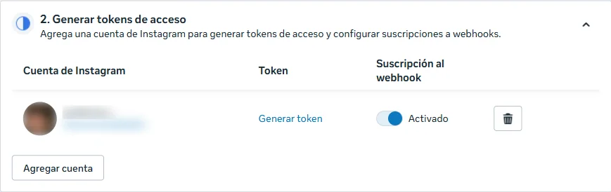

En esa misma sección, la columna **Suscripción al webhook** tiene que decir **Activado**. FChat la activa sola al conectar la cuenta. Si dice desactivado, en FChat, en **Tus canales**, toca **Reactivar webhooks**.

## 6. Publica tu app

Mientras la app está en modo Desarrollo, Meta solo avisa los comentarios de las personas que tienen un rol en ella. Al publicarla, funciona con todos.

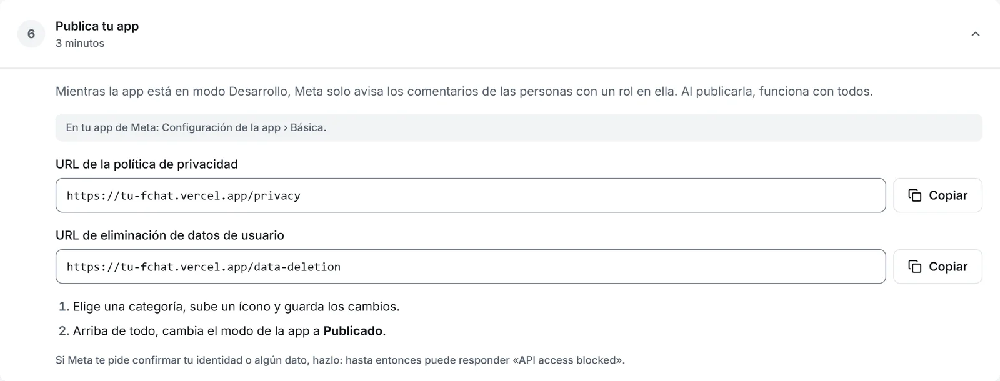

1. En Meta, en el menú de la izquierda: **Configuración de la app** › **Básica**. Completa:
   - **URL de la política de privacidad:** `https://tu-fchat.vercel.app/privacy`
   - En **Eliminación de datos de usuario**, elige **URL de instrucciones para la eliminación de datos** y pega `https://tu-fchat.vercel.app/data-deletion`.
   - **Ícono de la app:** una imagen cuadrada de 1024 × 1024 píxeles, por ejemplo tu logo.
   - **Categoría:** la que mejor describa tu negocio.

   Abajo de todo, toca **Guardar cambios**.

   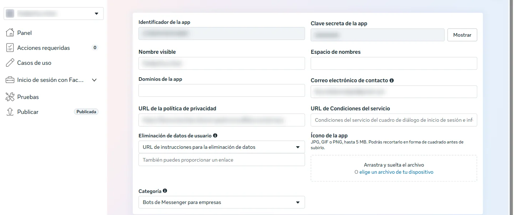

2. En el menú de la izquierda, toca **Publicar** y después el botón **Publicar** de abajo a la derecha. Al terminar, al lado de **Publicar** aparece **Publicada**.

   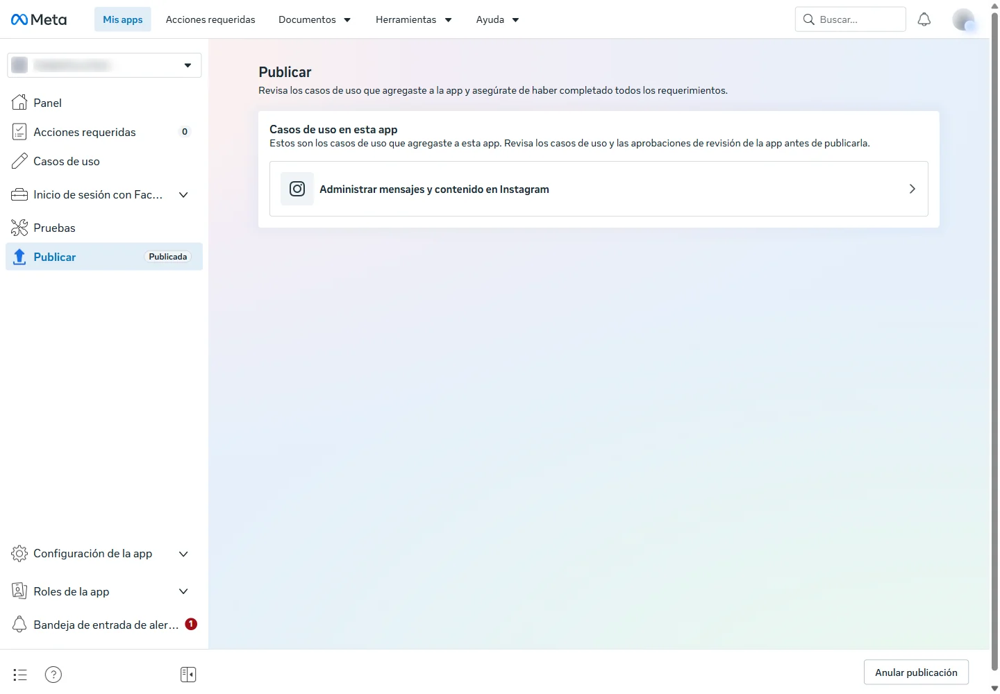

3. La sección **5. Completar la revisión de la app** se puede saltear: Meta aclara que no hace falta si solo usas la app para tus propias cuentas. No envíes la app a revisión.

   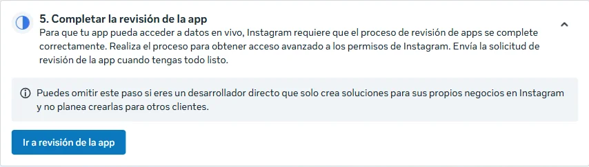

Si Meta te pide confirmar tu identidad, verificar tu cuenta o completar algún dato, hazlo. Mientras tanto, Instagram puede responder «API access blocked». Suele resolverse solo en unas horas después de completar lo que pide.

Las páginas `/privacy` y `/data-deletion` vienen con cada instalación. Son un punto de partida: revísalas y adáptalas a tu caso.

## 7. Crea tu primera automatización y pruébala

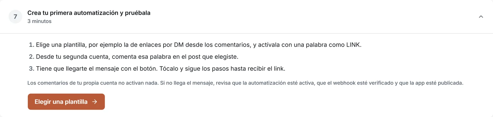

1. En FChat: **Automatizaciones** › **Plantillas** › **Enlaces de DM automáticos desde los comentarios**, o **Consigue seguidores antes de dar el link** si quieres que te sigan antes de recibirlo.
2. Elige el post, una palabra, por ejemplo `LINK`, y tu link. Toca **Publicar**.
3. Desde tu **segunda cuenta**, comenta `link` en ese post. Da igual si va en mayúsculas o minúsculas, con acento o sin acento.
4. A la segunda cuenta tiene que llegarle el mensaje con el botón. Tócalo y sigue los pasos hasta recibir el link. La conversación aparece en la **Bandeja** de FChat.

El recorrido completo, con capturas del asistente, la Bandeja y las estadísticas, está en el [README](../README.md#paso-6-crea-tu-primera-automatización).

## Si algo no funciona

**No llega el mensaje cuando comento.**

1. Comenta desde **otra cuenta**: los comentarios de tu propia cuenta no disparan nada.
2. Revisa que la automatización diga **Activa** y que esté en el post donde comentaste.
3. Revisa que la app de Meta diga **Publicada** y que el webhook esté verificado, con **comments**, **messages** y **messaging_postbacks** en **Suscritos**.
4. En Vercel › tu proyecto › **Logs**, comenta otra vez y mira si aparece un pedido a `/webhook` o `/api/webhooks/instagram`. Si no aparece nada, Meta no está avisando: revisa la URL del webhook y que la app esté publicada. Si aparece con el código 403, la clave secreta de la app no coincide: vuelve a pegarla en el paso 3.

**Llega el primer mensaje, pero al tocar el botón no pasa nada.** Falta la suscripción a **messaging_postbacks**, o falta **Permitir acceso a los mensajes** en la app de Instagram.

**Meta dice «API access blocked».** Meta está revisando tu cuenta de desarrollador o tu app. Entra a [developers.facebook.com](https://developers.facebook.com/apps/), revisa **Acciones requeridas** y la campana de avisos, y completa lo que pida. Suele resolverse en unas horas.

**El webhook no verifica.** La dirección tiene que terminar en `/webhook` y el token tiene que ser idéntico al de FChat. Tu FChat tiene que abrir en el navegador.

**«Conectar Instagram» da error.** Revisa que pegaste el identificador de la app **de Instagram**, no el de Meta, y que la URL de redireccionamiento esté guardada en Meta tal cual la copiaste de FChat. Como respaldo, conéctalo con un token como en el paso 5.

**Le pide que te siga aunque ya te sigue.** Instagram puede tardar unos segundos en informar un seguidor nuevo: que toque **Siguiendo** otra vez. Si nunca lo reconoce, en la automatización cambia **Veces que se lo pide** de «Hasta que me siga» a un número, por ejemplo 2: después de esos pedidos, el link llega igual.

## Límites de Instagram que conviene saber

- Se puede mandar **un mensaje privado por comentario**, dentro de los 7 días.
- Después, la conversación sigue solo si la persona responde o toca un botón, y dentro de las 24 horas desde su último mensaje.
- Para saber si alguien te sigue, Instagram exige que esa persona haya tocado algo antes. Por eso el primer mensaje lleva un botón.
- El acceso a Instagram dura 60 días. FChat lo renueva solo cada día con la tarea de `/api/cron`.
- Sin App Review, la app funciona para las cuentas de Instagram que conectas tú. Para manejar cuentas de otras personas, Meta pide revisar la app.
