# Connect Instagram with Meta, step by step

This guide sets up the Meta app that connects FChat to your Instagram account. It is the same 7-step guide you see in your dashboard under **Connect your accounts**, with a screenshot of every Meta screen. The app is yours and free: Meta gives you access to your own account without going through App Review.

It takes about 15 minutes and you only do it once. It works the same on Windows and Mac, since everything happens in the browser. Keep FChat open in one tab and Meta in another.

> **About the screenshots.** The FChat dashboard is available in English and Spanish, and the labels here are the English ones. The FChat screenshots show the Spanish interface. The Meta screenshots show the Meta dashboard in Spanish; yours follows the language of your Facebook account.

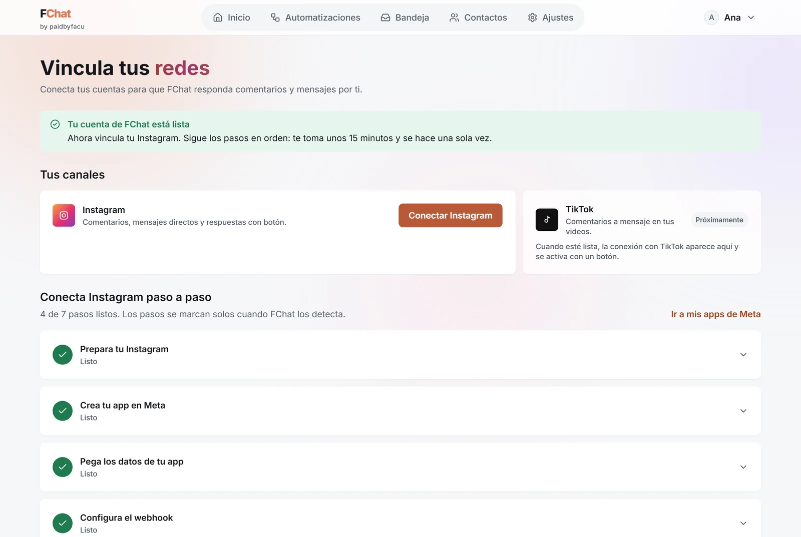

In the dashboard, every value you need to paste in Meta has a **Copy** button and already includes the address of your FChat. In this guide it appears as `https://your-fchat.vercel.app`: replace it with yours. Each step is checked off in FChat on its own once it detects you did it.

Meta, Vercel and GitHub change their dashboards often. If a button has a different name, look for the closest one. Screenshots are from November 2026.

**In this guide**

1. [Prepare your Instagram](#1-prepare-your-instagram)
2. [Create your app in Meta](#2-create-your-app-in-meta)
3. [Paste your app details in FChat](#3-paste-your-app-details-in-fchat)
4. [Set up the webhook](#4-set-up-the-webhook)
5. [Connect your Instagram account](#5-connect-your-instagram-account)
6. [Publish your app](#6-publish-your-app)
7. [Create your first automation and test it](#7-create-your-first-automation-and-test-it)
- [Troubleshooting](#troubleshooting)
- [Instagram limits worth knowing](#instagram-limits-worth-knowing)

## 1. Prepare your Instagram

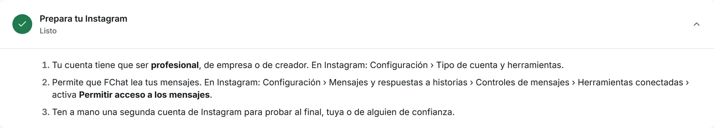

Do all of this in the Instagram app on your phone, with your account:

1. Your account must be **professional**, business or creator. Switch it in **Settings** › **Account type and tools** › **Switch to professional account**. It is free and you keep your followers.
2. Let FChat read your messages: **Settings** › **Messages and story replies** › **Message controls** › **Connected tools** › turn on **Allow access to messages**. Without this, Instagram does not notify FChat about messages.
3. Have a **second Instagram account** ready to test at the end. It can be a secondary account of yours or one from someone you trust. Comments from your own account do not trigger automations.

## 2. Create your app in Meta

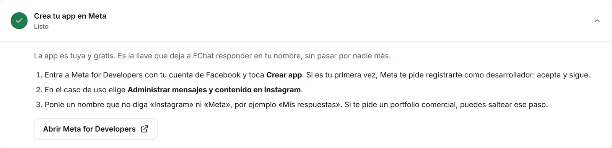

1. Go to [developers.facebook.com/apps](https://developers.facebook.com/apps/) with your Facebook account. If it is your first time, Meta asks you to register as a developer: accept the terms, confirm your account with the code you receive and continue. It is free.
2. In **Apps**, click **Create app**.

   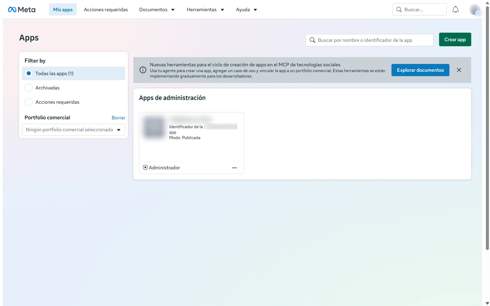

3. **App details.** Type a name that does not say "Instagram" or "Meta", for example "My replies". Meta does not accept names with its trademarks. Check the contact email and click **Next**.

   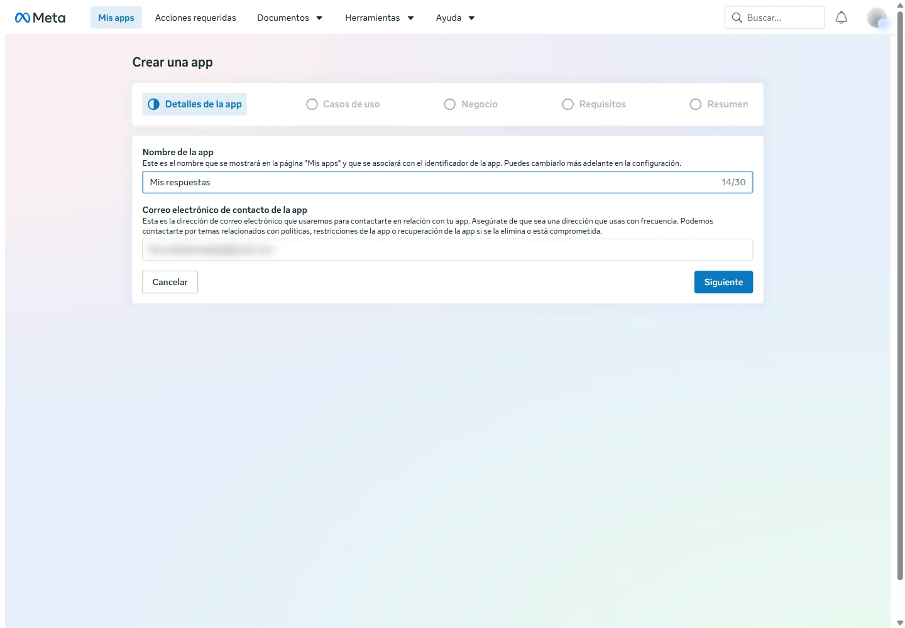

4. **Use cases.** The Instagram one is not under "Featured": in the list on the left click **Business messaging** and select **Manage messaging & content on Instagram**. At the bottom it should say "1 use case added". Click **Next**.

   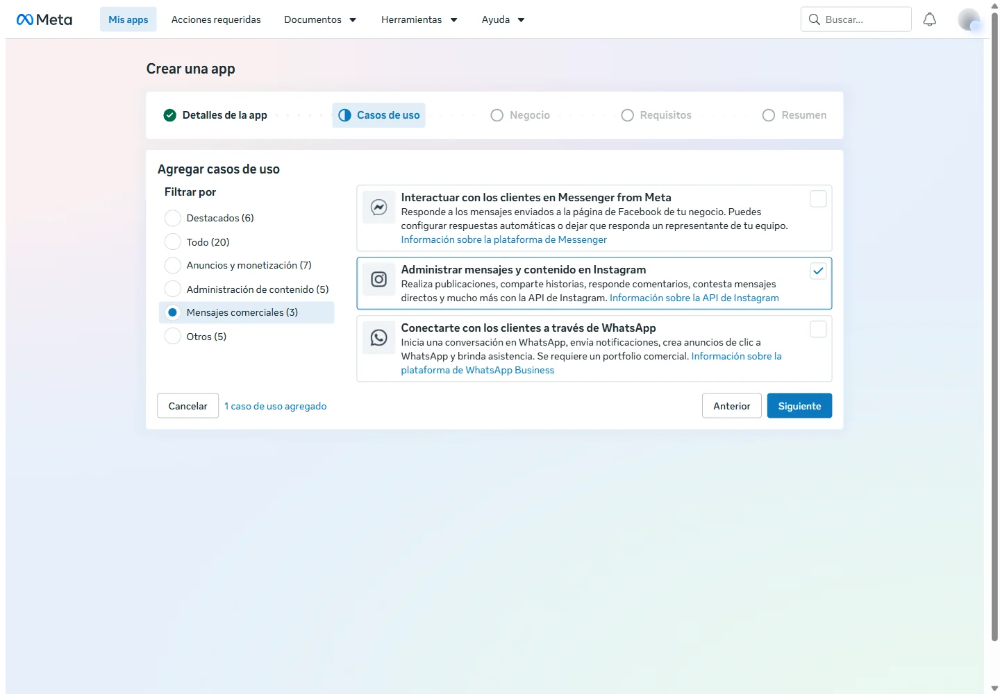

5. **Business.** Select **I don't want to connect a business portfolio yet.** and click **Next**. If you already have a Meta Business portfolio you can pick it: it makes no difference for FChat.

   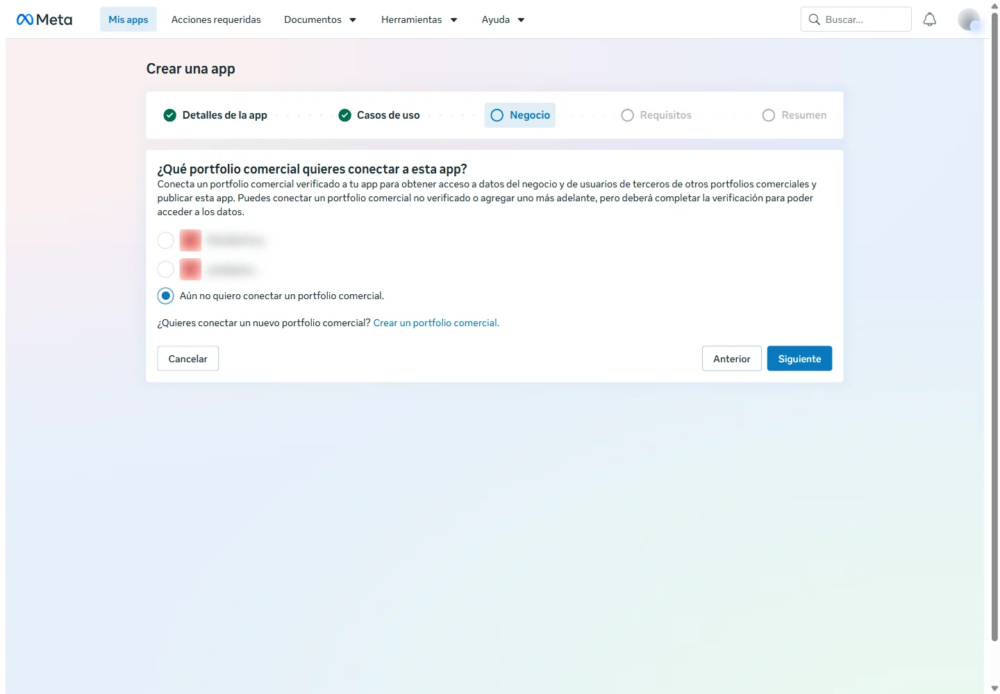

6. **Requirements.** It should say that no requirements were identified. Click **Next**.
7. **Overview.** Check that the Instagram use case is listed and click **Create app**. Meta may ask for your Facebook password.

   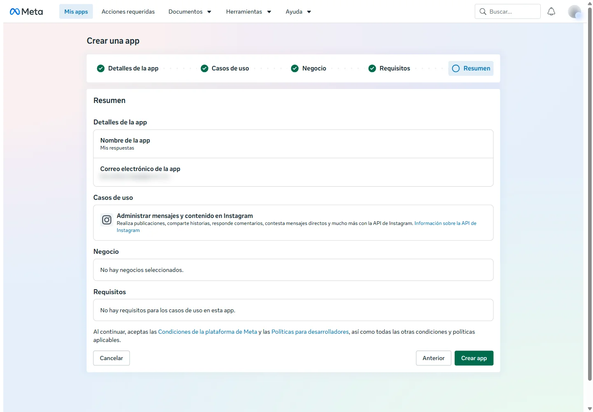

You land on your app's **Dashboard**. At the bottom, under **Use cases in this app**, click **Manage messaging & content on Instagram**: everything for steps 3, 4 and 5 is there.

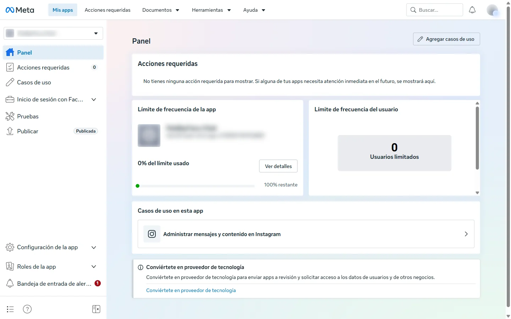

## 3. Paste your app details in FChat

In Meta you are now in **Use cases** › **Customize**. The top of the left menu should say **Instagram API**. In that menu, click **API setup with Instagram login**.

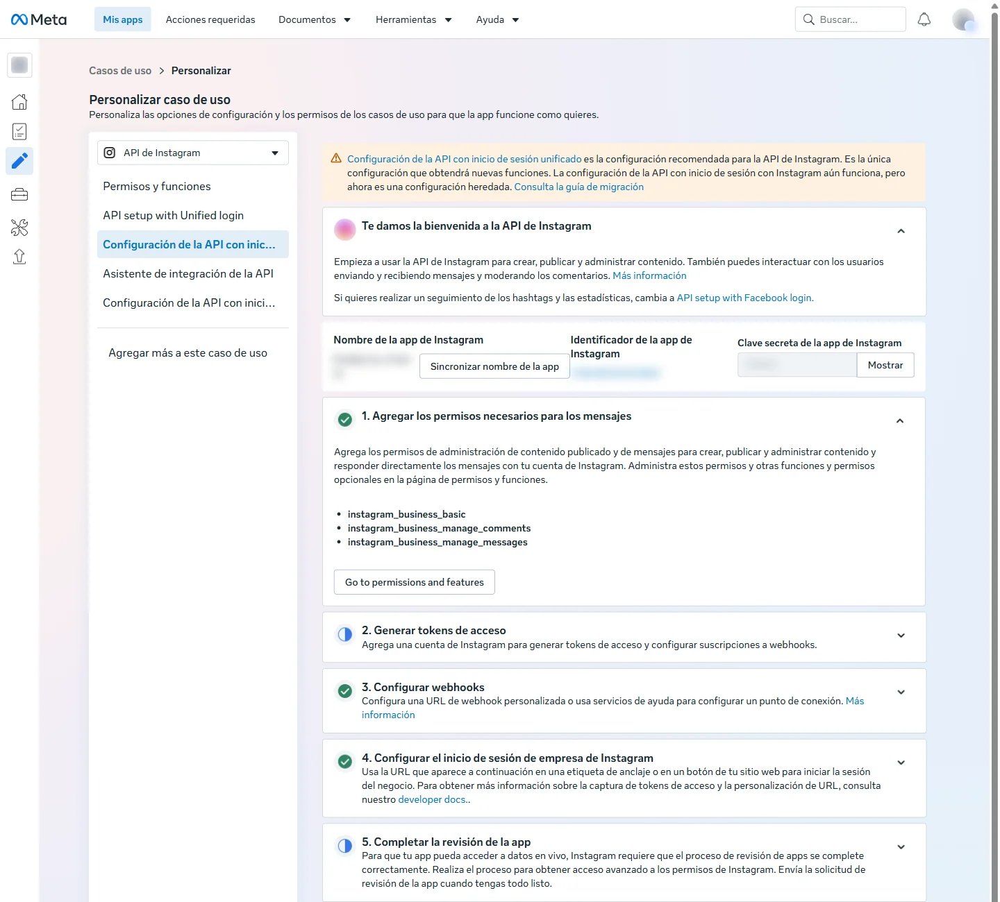

Meta shows an orange notice recommending "unified login". FChat uses the setup with Instagram login, which still works: you can ignore that notice.

Copy these two values from the card at the top:

- **Instagram app ID**: a long number.
- **Instagram app secret**: click **Show** to see it. Meta may ask for your Facebook password.

Paste them in FChat, in step 3 of **Connect your accounts**, and click **Save changes**. You should see a confirmation that they were saved.

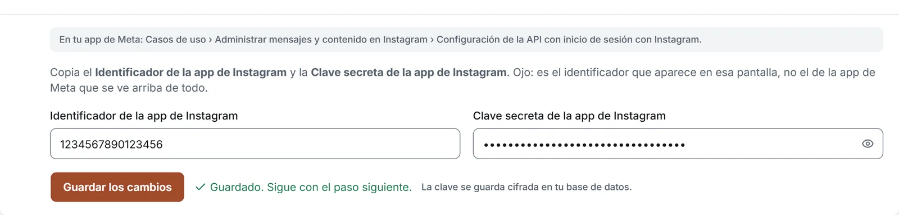

- **Careful:** it is the **Instagram** app ID, the one on that card. It is not the Meta app ID shown at the very top or in App settings › Basic. If you paste the other one, the "Connect Instagram" button fails.
- Section **1. Add required messaging permissions** already includes `instagram_business_basic`, `instagram_business_manage_comments` and `instagram_business_manage_messages`. You do not need to change anything.
- FChat stores the secret encrypted in your database. If you prefer, you can set both values in Vercel as `IG_APP_ID` and `IG_APP_SECRET`: the variables take priority over what you paste in the dashboard.

## 4. Set up the webhook

The webhook is the address where Meta notifies FChat about every comment and message.

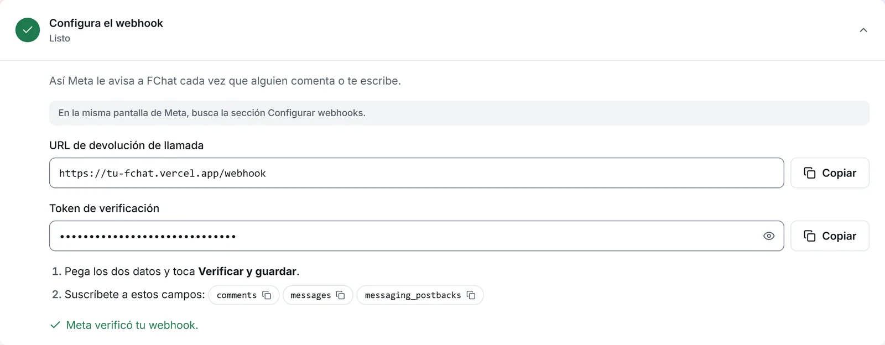

On the same Meta screen, open section **3. Configure webhooks**:

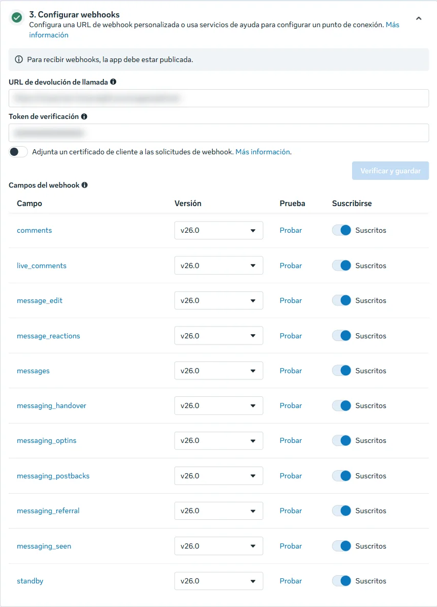

1. **Callback URL:** paste the one you copied from FChat, in this format: `https://your-fchat.vercel.app/webhook`.
2. **Verify token:** paste the one FChat shows in step 4. Use the **Copy** button so no spaces sneak in.
3. Click **Verify and save**. Once Meta verifies it, FChat shows that Meta verified your webhook and the step is checked off on its own.
4. In the field table below, turn on **Subscribed** for **comments**, **messages** and **messaging_postbacks**. The rest can stay off.

The screenshot shows every field set to **Subscribed** because it is a test app. Those three are all FChat needs.

Above that section Meta warns that the app must be published to receive webhooks. That is expected: you publish it in step 6.

If verification fails:

- Check that the address ends in `/webhook` with no extra slash.
- Check that the token is identical: copy it again with the button.
- Open your FChat in the browser: if it does not load, Meta cannot reach it either.

## 5. Connect your Instagram account

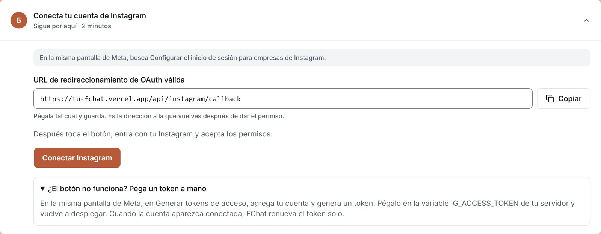

1. In FChat, in step 5, copy the **Valid OAuth redirect URI**. It looks like this: `https://your-fchat.vercel.app/api/instagram/callback`.
2. In Meta, in section **4. Set up Instagram business login**, click **Business login settings**.

   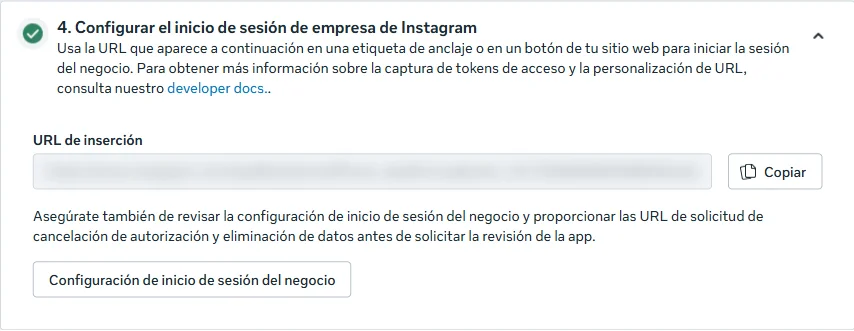

3. In the window that opens, paste the address under **OAuth redirect URIs** and click **Save**. The other two fields are optional.

   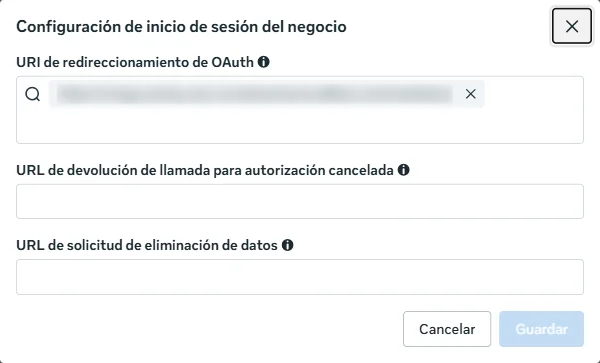

4. Go back to FChat and click **Connect Instagram**. Log in with the Instagram account you want to automate and accept the permissions.

When you come back, FChat confirms that Instagram is connected and your account shows up in **Your channels** as **Connected**. Access lasts 60 days and FChat renews it on its own every day.

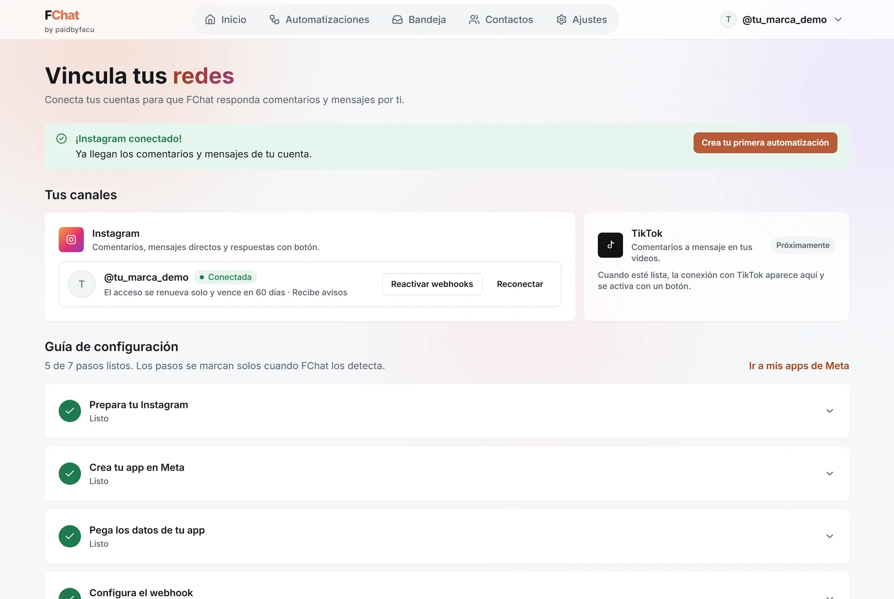

If another Instagram account is logged in on your browser, Instagram connects that one. Log out on instagram.com or use a private window before clicking **Connect Instagram**.

**If the button does not work, connect with a token.** In Meta, in section **2. Generate access tokens**, click **Add account** and log in with your Instagram. Next to your account click **Generate token** and copy it. Paste it in Vercel as the `IG_ACCESS_TOKEN` variable, of type **Secret**, and publish again with **Redeploy**. Both steps are explained with screenshots in the README, in [Add or change a variable](../README.md#add-or-change-a-variable) and [Redeploy](../README.md#redeploy). FChat imports it on startup and renews it on its own afterwards.

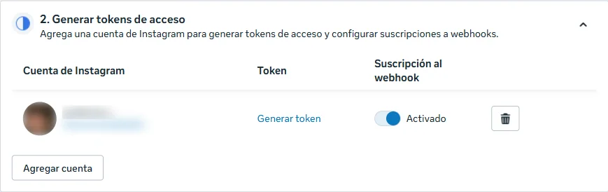

In that same section, the **Webhook subscription** column should say it is on. FChat turns it on by itself when it connects the account. If it is off, click **Reactivate webhooks** under **Your channels** in FChat.

## 6. Publish your app

While the app is in Development mode, Meta only sends comments from people who have a role in it. Once published, it works for everyone.

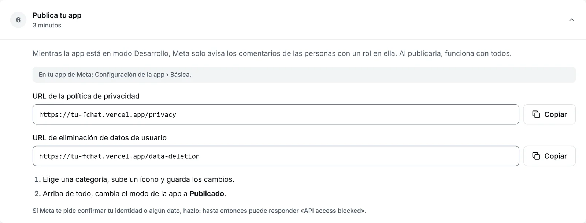

1. In Meta, in the left menu: **App settings** › **Basic**. Fill in:
   - **Privacy policy URL:** `https://your-fchat.vercel.app/privacy`
   - Under **User data deletion**, choose **Data deletion instructions URL** and paste `https://your-fchat.vercel.app/data-deletion`.
   - **App icon:** a square 1024 × 1024 pixel image, for example your logo.
   - **Category:** the one that best describes your business.

   At the very bottom, click **Save changes**.

   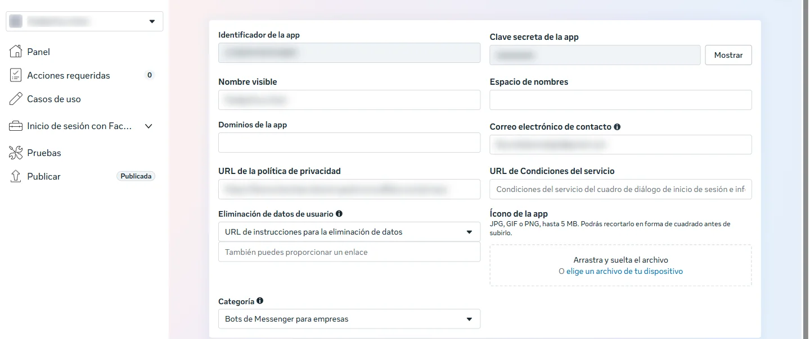

2. In the left menu, click **Publish** and then the **Publish** button at the bottom right. When it is done, **Published** appears next to **Publish**.

   The screenshot is from an app that was already published, which is why it says **Published**. On yours, that word only appears after you click the **Publish** button.

   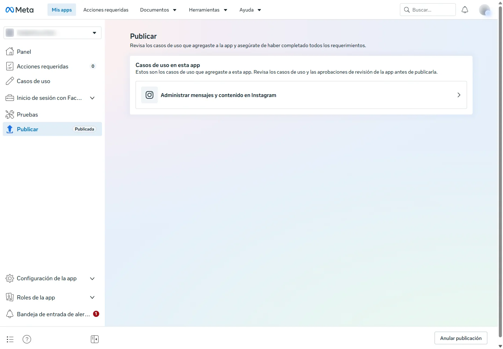

3. Section **5. Complete app review** can be skipped: Meta says it is not needed if you only use the app for your own accounts. Do not submit the app for review.

   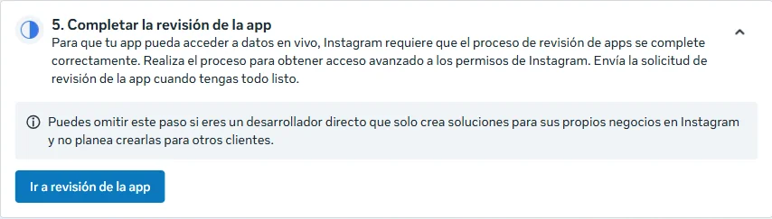

If Meta asks you to confirm your identity, verify your account or complete any detail, do it. Meanwhile Instagram may answer "API access blocked". It usually clears up on its own a few hours after you complete what it asks.

The `/privacy` and `/data-deletion` pages come with every installation. They are a starting point: review them and adapt them to your case.

## 7. Create your first automation and test it

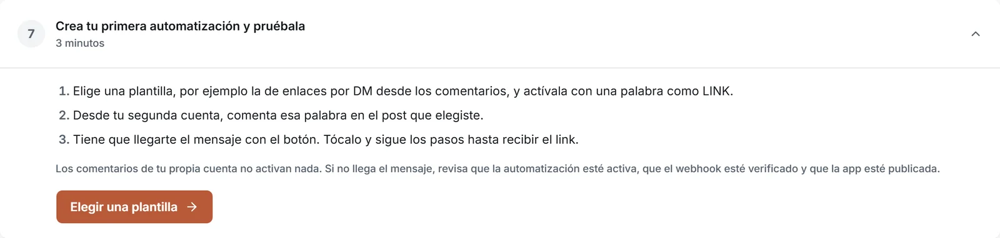

1. In FChat: **Automations** › **Templates** › **Auto-DM links from comments**, or **Get followers before sending the link** if you want people to follow you before they get it.
2. Pick the post, a keyword such as `LINK`, and your link. Click **Publish**.
3. From your **second account**, comment `link` on that post. Upper or lower case and accents do not matter.
4. The second account should receive the message with the button. Tap it and follow the steps until you get the link. The conversation shows up in the FChat **Inbox**.

The full walkthrough, with screenshots of the wizard, the Inbox and the stats, is in the [README](../README.md#step-6-create-your-first-automation).

## Troubleshooting

**No message arrives when I comment.**

1. Comment from **another account**: comments from your own account do not trigger anything.
2. Check that the automation says **Active** and that it is set on the post where you commented.
3. Check that the Meta app says **Published** and that the webhook is verified, with **comments**, **messages** and **messaging_postbacks** set to **Subscribed**.
4. In Vercel › your project › **Logs**, comment again and look for a request to `/webhook` or `/api/webhooks/instagram`. If nothing shows up, Meta is not sending notifications: check the webhook URL and that the app is published. If it shows up with status 403, the app secret does not match: paste it again in step 3.

**The first message arrives, but tapping the button does nothing.** The **messaging_postbacks** subscription is missing, or **Allow access to messages** is off in the Instagram app.

**Meta says "API access blocked".** Meta is reviewing your developer account or your app. Go to [developers.facebook.com](https://developers.facebook.com/apps/), check **Required actions** and the notifications bell, and complete what it asks. It usually clears up in a few hours.

**The webhook does not verify.** The address must end in `/webhook` and the token must be identical to the one in FChat. Your FChat must open in the browser.

**"Connect Instagram" fails.** Check that you pasted the **Instagram** app ID, not the Meta one, and that the redirect URL is saved in Meta exactly as you copied it from FChat. As a fallback, connect with a token as in step 5.

**It asks people to follow even though they already follow you.** Instagram can take a few seconds to report a new follower: have them tap **Following** again. If it never recognizes them, change **Times to ask** in the automation from **Until they follow** to a number, for example 2: after that many asks, the link is sent anyway.

## Instagram limits worth knowing

- You can send **one private reply per comment**, within 7 days.
- After that, the conversation continues only if the person replies or taps a button, and within 24 hours of their last message.
- To know whether someone follows you, Instagram requires that person to have tapped something first. That is why the first message has a button.
- Instagram access lasts 60 days. FChat renews it on its own every day with the `/api/cron` task.
- Without App Review, the app works for the Instagram accounts you connect yourself. To manage other people's accounts, Meta requires an app review.
